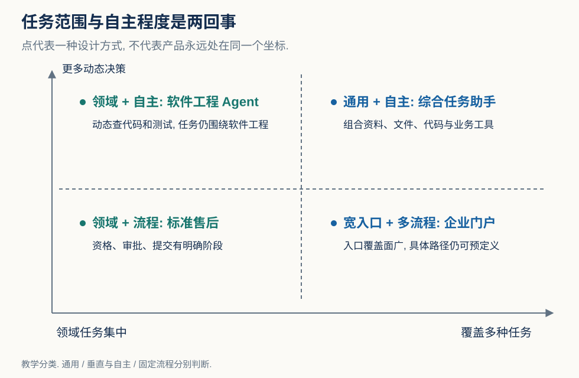
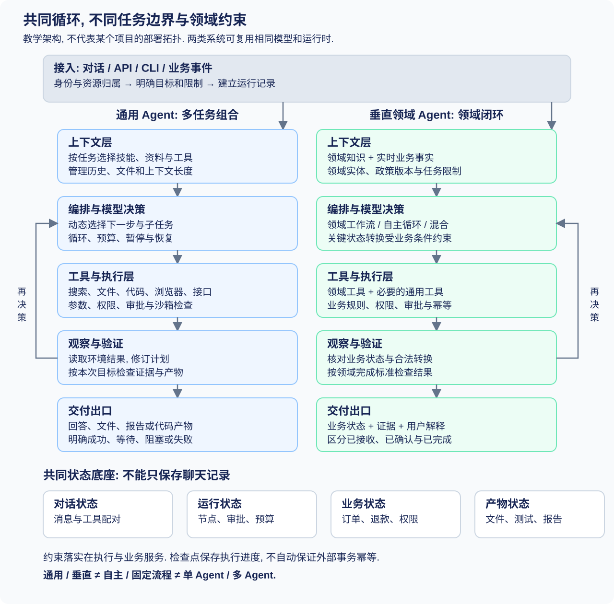
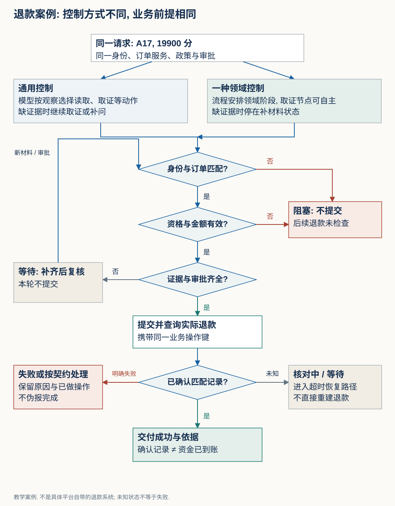

# 通用 Agent 与垂直领域 Agent: 架构、完整流程与真实实现

**两者通常共享“模型决策 → 工具执行 → 环境反馈”的循环. 主要差异在于任务边界、领域知识、工具语义、约束方式和完成标准.** 通用 Agent 更依赖可组合能力处理未知任务, 垂直领域 Agent 更依赖领域模型和业务系统完成特定工作. 自主程度是另一条独立维度, 不能把垂直 Agent 等同于固定工作流.

- 学习目标: 能画出两类系统的完整架构, 追踪一次任务的数据和控制流, 解释真实代码中每层的职责, 并验证写操作是否真正完成.
- 前置知识: 基本 Python、网络接口调用、数据库读写. 涉及模型、检索与编排的概念会在首次出现时解释.
- 分类: Agent. 内容类型: 技术对比.
- 核查日期: 2026-10-18, Asia/Shanghai.
- 验证状态: 官方资料在线读取与指定文件静态阅读已完成; 配套离线练习已在 Python 3.12.14 下通过 10 个场景检查. 未运行 Deep Agents、OpenHands 或 Dify 的完整服务, 未调用付费模型或真实退款接口.
- 配套: [开发与测试面试专题](../../interviews/agent/general-vs-domain-agents.md), <a href="/examples/general-vs-domain-agents/practice.py" download>离线练习源码</a>, [实际执行记录](/examples/general-vs-domain-agents/practice-results.txt).

## 1. 定义与阅读地图

### 1.1 本文所说的 Agent 是什么

Agent (智能体) 是围绕目标, 根据观察选择动作、调用工具并继续处理反馈的系统. LLM (Large Language Model, 大语言模型) 驱动的 Agent 通常把“下一步做什么”的一部分交给模型, 把动作执行交给软件运行时. 模型、Agent 程序、运行环境和业务系统是不同组件.

**通用 Agent (General-purpose Agent, 通用智能体)** 面向多种任务族. 例如同一个入口能够检索资料、分析表格、编写程序和生成报告. 通用指适用任务较宽, 不代表拥有所有数据、权限和工具, 更不表示已经实现通用人工智能.

**垂直领域 Agent (Domain-specific / Vertical Agent, 领域智能体)** 围绕特定领域或业务角色设计. 例如软件工程 Agent、售后 Agent、数据分析 Agent. 它可能执行很长的自主循环, 也可能由确定的工作流限制关键步骤.

领域是相对的: 编程 Agent 相对办公助手是垂直的; 面向整个软件工程的 Agent 相对只修复一种构建故障的 Agent 又更通用. 本文按系统的目标任务集合、可访问资产和交付标准判断, 不按产品名字判断.

### 1.2 两个维度必须分开

Workflow (工作流) 的主要执行路径由程序或流程图定义; Agent loop (智能体循环) 允许模型在运行时选择下一动作. 这是控制方式的区别. Anthropic 与 LangGraph 的官方解释均采用这个维度, 它们没有把它直接等同于“通用/垂直”. [Anthropic: What are agents?](https://www.anthropic.com/engineering/building-effective-agents), [LangGraph: Workflows and agents](https://docs.langchain.com/oss/python/langgraph/workflows-agents).

[](/images/general-vs-domain-agents/two-axes.svg)

读图: 横轴看覆盖多少任务, 纵轴看下一步主要由谁决定. 图中是教学分类, 不表示某产品永远固定在一个坐标.

| 组合 | 示例 | 实际控制方式 |
| --- | --- | --- |
| 通用 + 较强自主 | 带搜索、文件、代码执行能力的综合助手 | 根据任务和反馈动态组合工具 |
| 垂直 + 较强自主 | 软件工程 Agent | 动态查代码、修改、测试和再修复 |
| 垂直 + 工作流为主 | 标准售后处理系统 | 资格、审批和提交路径主要由业务状态机决定 |
| 宽任务入口 + 多个工作流 | 企业综合助理门户 | 入口覆盖面广, 路由到多个已定义流程 |

Multi-agent (多智能体, 多个决策上下文协作) 也是独立选择. 单 Agent 可以通用, 多 Agent 也可能只服务一个垂直场景.

### 1.3 真实参考项目与阅读范围

下面选取有公开实现、能对应关键机制的代表项目, 不把它们当成市场份额排名. Dify 有完整中文官方文档; Deep Agents 与 OpenHands 的代码和核心架构资料以英文为主, 本文中文解释其已读取部分.

| 项目与定位 | 本次固定代码快照 | 已实际阅读 | 本文如何使用 |
| --- | --- | --- | --- |
| Deep Agents, 通用 Agent harness (智能体运行支架) | [`97f856d`](https://github.com/langchain-ai/deepagents/tree/97f856dcb08264ef78722a4687cab9133ec5fb7a), `pyproject.toml` 声明 `0.7.28` | `libs/deepagents/deepagents/graph.py`, 包配置, 官方 Overview | 解释通用循环如何装配上下文、文件、子任务与人工介入 |
| OpenHands Software Agent SDK (软件开发工具包), 面向代码工作的 Agent 实现 | [`6ae6407`](https://github.com/OpenHands/software-agent-sdk/tree/6ae64079cfd30cfe2f01a060c59168a4d650d883), SDK 包声明 `1.55.1` | README, `agent.py`, `local_conversation.py`, 包配置, 官方架构页 | 展示一个垂直领域系统仍能动态决策与执行 |
| Dify, Agent 与工作流构建平台 | [`b953e69`](https://github.com/langgenius/dify/tree/b953e69a0eb397e625337812e0319ab770f18783), API 包声明 `1.17.1` | 经典 `AgentNode._run`, API/前端依赖与 Compose 配置, 官方 Agent 节点页 | 展示工作流包裹局部自主循环的实现位置 |
| LangGraph, 图执行运行时 | 官方滚动文档, 2026-10-18 在线核查, 未固定库代码版本 | Workflows and agents、Persistence | 解释图、检查点与跨会话存储 |

版本号是读取快照中声明的版本, 不是本机已安装版本或“最新稳定版”承诺. 没有阅读整库所有入口、部署逻辑或测试. Dify 新旧 Agent 路径共存, 下文源码追踪仅针对经典节点, 不把它泛化成新版 Agent 的全部实现.

## 2. 共同架构: 六层职责与四种状态

### 2.1 先看共同骨架

[](/images/general-vs-domain-agents/architecture.svg)

读图: 顶部请求经过身份和任务处理进入运行时. 中间形成“构建上下文 → 决策 → 校验与执行 → 观察”的循环. 下方的业务状态、运行状态和产物不会因一句自然语言回答而自动一致. 两列表示常见侧重点, 不是某一个项目的部署拓扑.

| 层 | 负责什么 | 关键输入与输出 | 不应承担什么 |
| --- | --- | --- | --- |
| 接入层 | 接收对话、事件或定时任务, 验证身份, 建立运行标识, 返回进度 | 用户请求 → 任务信封 | 仅靠用户文本决定其身份和权限 |
| 编排与控制层 | 生命周期、节点调度、循环、暂停、恢复、预算和取消 | 任务与状态 → 下一次可执行步骤 | 把模型的“我完成了”直接当成业务事实 |
| 上下文层 | 选择本轮需要的指令、历史、事实、工具描述 | 全量资产 → 受长度限制的模型输入 | 把所有文档与历史无限拼接 |
| 模型决策层 | 理解、拆解、参数生成、动作选择、结果组织 | 消息和工具说明 → 工具请求或回答 | 真正执行本地函数或完成数据库事务 |
| 工具与执行层 | 参数检查、鉴权、调用服务、隔离代码执行、归一化结果 | 动作请求 → 观察与执行状态 | 因为模型“想调用”就授予额外权限 |
| 验证与交付层 | 检查任务标准与业务结果, 生成产物、引用和运行结论 | 证据与真实状态 → 可交付结果 | 把生成文本正确等同于动作正确 |

这是一份教学分层. 一个小程序可以把几层写在同一进程里; 分层并不要求拆成六个微服务.

### 2.2 状态为什么不能只存一份聊天记录

| 状态 | 例子 | 谁提供事实 | 如何保存 |
| --- | --- | --- | --- |
| 对话状态 | 消息、工具请求及对应结果 | 模型接口与工具运行时 | 消息表或框架状态 |
| 运行状态 | 当前节点、待审批动作、重试次数、剩余预算 | 编排运行时 | Checkpoint (检查点, 可恢复的执行状态快照) |
| 业务状态 | 订单归属、退款状态、实际退款金额 | 订单与退款服务 | 业务数据库与服务接口 |
| 产物状态 | 报告文件、代码改动、测试结果、下载地址 | 文件或构建系统 | 文件系统或对象存储 |

Long-term memory (长期记忆, 跨会话保存的偏好或事实) 属于额外的数据资产, 不能取代以上状态. RAG (Retrieval-Augmented Generation, 检索增强生成) 取回知识作为本轮依据, 也不等于执行恢复机制.

LangGraph 明确区分 Checkpointer (检查点持久化器) 与 Store (跨会话数据存储): 前者保存一个 thread (会话执行线) 的图状态, 后者保存应用定义的跨 thread 数据. 内存实现重启会丢失, 持久化能力还取决于选择的存储后端. [LangGraph: Persistence](https://docs.langchain.com/oss/python/langgraph/persistence).

### 2.3 每次请求之前, 哪些能力已经准备好

下面是教学准备流程, 不代表三个参考项目都内置全部步骤:

| 准备项 | 输入到输出 | 对通用与垂直系统的影响 |
| --- | --- | --- |
| 模型连接 | 模型提供商、模型标识、接口能力 → 可调用的模型适配层 | 两者都要确认工具调用和输出格式支持, 不能仅靠同名方法假定兼容 |
| 工具注册 | 函数、描述、参数结构、执行器 → 工具目录 | 通用系统常维护较宽目录, 领域系统通常维护更强业务语义 |
| 知识入库 | 原始文档 → 解析、分段、元数据、索引 | 通用资料可按任务加载, 领域资料通常需要持续管理版本和适用范围 |
| 身份与服务接入 | 可信身份、服务凭证、授权规则 → 可访问的资源边界 | 认证信息由执行层管理, 不把密钥拼入模型提示词 |
| 状态与产物存储 | 存储配置、保留策略 → 检查点、业务关联和文件位置 | 决定暂停恢复与交付链接是否有效 |
| 执行环境 | 文件、工具依赖和隔离配置 → 可用的本地或远程工作环境 | 通用代码任务与软件工程领域任务都可能需要沙箱 |

知识入库与在线检索尤其容易混淆. 一种常见准备链是“文档解析 → 分段 → 附加版本和权限元数据 → Embedding (嵌入编码, 将文本转换成检索向量) → 建立索引”. 在线阶段才是“按问题检索 → 过滤或重排序 → 把证据加入上下文”. 全文检索或外部知识接口不一定经过向量编码. 更新文档索引也不等于重新训练模型. Dify 官方知识库概述明确区分知识导入、索引与检索配置、元数据管理及应用内使用. [Dify 知识库](https://docs.dify.ai/zh/cloud/use-dify/knowledge/readme).

实际执行还需要调度隔离: 同一会话的状态变更要避免并发覆盖, 不同用户的运行不能共享可变身份和工作目录. 长任务可以由后台执行器运行, 通过事件向客户端提供进度; 是否进入任务队列取决于应用实现. 客户端断开连接是否取消任务, 也必须有明确契约, 不能把网络连接寿命直接当成业务任务寿命.

## 3. 通用 Agent: 从入口到出口

下面采用一个跨资料、表格和业务系统的教学任务:

> “分析 A17 订单的售后情况, 核对我上传的表格与政策, 如果符合条件, 退还 199 元, 并给出依据.”

假设已经提供订单工具、政策资料、表格解析工具与退款服务; 用户身份由接入层确认. 没有这些能力时, 通用 Agent 只能停在分析、说明缺失或申请接入, 不会因为“通用”自动拥有业务权限.

### 3.1 入口: 把自然语言转换成任务信封

入口可能是 Web 对话、CLI (命令行界面)、API (应用程序接口)、工单事件或计划任务. 它们先进入接入层, 而不是直接让模型执行一句任意文本.

接入层完成身份验证、附件登记和请求去重后创建运行记录. 一次运行可以关联多个用户轮次, 也可能暂停后跨进程恢复. `request_id` 用于关联请求, `run_id` 标识执行, 业务幂等键另行定义, 三者不能随意混用.

以下 JSON (结构化数据格式) 是教学契约, 不是某 SDK 的实际返回:

```json
{
  "run_id": "run-demo-001",
  "principal": {"tenant_id": "tenant-demo", "user_id": "user-demo"},
  "task": "核对 A17 的售后情况并处理符合条件的退款",
  "attachments": ["artifact://input/sales.csv"],
  "constraints": {"order_id": "A17", "max_amount_cents": 19900},
  "status": "accepted"
}
```

`principal` 是服务端身份上下文. 模型不能把用户说的“我是管理员”写进去就取得权限. 附件地址还需由存储服务校验其归属, 不能把任意路径直接当作可信文件.

### 3.2 任务澄清与能力检查

模型或接入规则先识别目标、限制和缺失条件: 199 元是上限还是指定金额? 是否允许实际提交? 订单是哪一个? 要交付文字还是报表?

此阶段输出的是任务约束与待补条件, 而不一定是一份很长的计划. 已明确的条件应进入结构化状态; 后续上下文压缩时不应只靠摘要记住它们.

通用 Agent 还需检查能力是否存在: 能读取表格不代表能写退款系统; 有浏览器不代表能访问登录后的管理后台; 有工具描述不代表当前身份获准使用它.

### 3.3 上下文装配: 决定这一轮模型能看到什么

Context engineering (上下文工程, 按当前步骤组织模型输入) 通常包括:

1. 加载系统行为和用户限制, 明确信任边界.
2. 根据任务选择工具及其 Schema (结构规范, 描述字段类型与必填项).
3. 加载相关历史和运行摘要.
4. 检索政策、订单说明或文件片段, 保留来源和版本.
5. 按需读取 Skill (技能包, 可复用的领域操作说明及资源).
6. 控制 token (模型处理的文本单位) 数量, 为本轮输出和后续工具结果预留空间.

工具很多时, 可以先做目录检索或按任务开放工具集合. 这减少模型选择负担, 但**工具可见范围与服务端权限不是一回事**. 权限仍由执行层核验.

检索结果和外部文件是资料, 不是新的系统指令. 例如政策页面夹入“忽略金额上限”属于 Prompt injection (提示注入, 不可信内容试图改变行为), 不能修改已确认的运行约束.

### 3.4 规划与决策: 计划可以调整

模型根据当前输入生成下一步动作, 例如先读订单, 再读政策, 最后比较表格. 常见机制有:

| 机制 | 怎样工作 | 何时有意义 | 代价与边界 |
| --- | --- | --- | --- |
| ReAct (Reasoning and Acting, 推理与行动交替) 式循环 | 看观察、选择动作、继续处理结果 | 后续动作依赖当前发现 | 容易累积错误或循环, 必须有运行边界 |
| Plan-and-execute (先规划后执行) | 先给子目标, 执行时按新证据修订 | 多步任务存在依赖关系 | 旧计划可能失效, 计划本身不证明完成 |
| Orchestrator-workers (编排者与工作者) | 主控拆解任务, 独立上下文完成子任务, 主控汇总 | 子任务边界清楚且可独立验证 | 增加协调、上下文传递和冲突处理成本 |
| Evaluator-optimizer (评估与改进循环) | 生成结果, 按标准评价, 再修订 | 评价标准能实际识别改进 | 多一个模型评价也可能同样判断错 |

这些模式可组合, 不要求单独训练规划模型, 也不要求把隐藏推理过程暴露给用户. 可观测记录应优先保留动作、参数、简短理由、工具结果和验证证据. 模式来源见 [Anthropic: Building blocks, workflows, and agents](https://www.anthropic.com/engineering/building-effective-agents).

### 3.5 模型输出: 工具调用请求不是工具已经执行

Tool calling (工具调用, 模型生成结构化动作请求) 的基本链路是:

```text
运行时发送: 当前消息 + 工具说明 + 参数结构
模型返回: call_id=c1, tool=get_order, arguments={order_id: A17}
运行时检查并执行: 订单服务
工具返回: 与 c1 关联的结果或错误
运行时把观察追加到下一轮模型上下文
```

上面是协议无关的教学表示. 不同提供商在字段名和消息格式上有差异. 关键是通过调用标识将请求和结果配对, 不丢失、错配或把未执行的动作当作观察.

模型也可能直接返回最终回答. 对查资料任务, 这可能已经足够; 对退款任务, 运行时仍需检查是否有可验证的提交结果.

### 3.6 执行前检查: 把“想做”转换成“可以做”

Dispatcher (工具分发器, 选择实际执行函数的运行组件) 根据工具名定位实现, 随后检查:

- 参数的结构和取值是否有效, 金额采用整数分还是小数元.
- 用户、租户和目标订单是否匹配, 由服务端身份决定查询范围.
- 此动作是否在任务授权和本次业务条件内.
- 写操作是否需要已记录的审批, 审批绑定的目标与金额是否仍一致.
- 是否具有幂等键, 外部调用超时后怎样确认实际结果.

Sandbox (沙箱, 限制代码和进程活动的执行环境) 主要控制文件、网络、进程和资源访问. 退款服务鉴权控制业务访问. 两者不可互相替代. 接上 MCP (Model Context Protocol, 模型连接工具与数据的协议) 可以统一连接方式, 但不能替应用完成业务授权. 协议的 Host、Client、Server 分工与工具路由见 [MCP 官方架构说明](https://modelcontextprotocol.io/docs/2026-07-28/learn/architecture).

通用 Agent 的执行面可能有浏览器、Shell (命令行解释器)、代码解释器和文件工具. 它们能组合很多动作, 因而更需要把约束落实到真实执行边界. 只在提示词里写“不越权”不能形成强制保证.

### 3.7 观察与重规划: 根据环境事实前进

执行结果应包含可使用的结构化字段, 如业务状态、错误类别、资源标识和证据位置. 很大的表格或日志可以存到文件, 给模型返回摘要和可继续读取的路径, 不必全部塞入消息.

模型再判断: 是否需要更多数据? 参数是否要修正? 是否已满足目标? 是暂时失败还是权限阻塞? 例如订单服务返回“不属于当前用户”, 这应成为阻塞结论, 而不是尝试另一个身份绕过.

网络暂时失败可能适合受限重试; 参数错误需要改参数; 无权限需要停止对应动作; 写入后超时需要核对结果. **把所有错误都简单重试, 会把推理错误放大成业务错误.**

### 3.8 长任务: 预算、持久化与恢复

通用任务步数较难预估. 运行时需要明确最大步骤、token/费用预算、截止时间与取消语义. 框架允许很大循环上限不代表业务预算已经合理配置.

恢复需要回答两个问题:

1. 程序到哪一步了? 从检查点恢复消息、节点和待执行动作.
2. 外部动作发生了吗? 用业务标识、幂等键和服务查询核对.

两者之间存在时间窗口: 退款已写入, 但程序来不及保存检查点. 单独持久化消息不能消除重复执行. Idempotency (幂等, 同一业务操作重复请求不产生重复效果) 必须由有约束的服务实现, 不能只让模型记住“别再退一次”.

### 3.9 出口: 满足验收标准后交付

出口不是只有一句聊天回复. 它可能包含结构化状态、报告、代码改动、测试结果和证据引用.

对本例, 交付需要区分:

- `succeeded`: 目标退款记录经服务查询确认, 金额与订单匹配.
- `awaiting_approval`: 已有可审查动作, 尚未获准提交.
- `blocked`: 缺少身份、权限、数据或能力.
- `failed`: 执行失败且本轮未解决.
- `cancelled`: 用户或系统取消, 同时说明已发生的副作用.

以上状态是教学定义. HTTP (网络应用协议) 响应成功、SSE (Server-Sent Events, 服务端向客户端持续推送事件) 流关闭、模型停止输出, 都不能独立证明业务成功. 流式输出的“正在退款”也不能提前成为最终业务状态.

## 4. 垂直领域 Agent: 相同循环如何嵌入领域系统

垂直化不只是加一句“你是售后专家”. 真正的领域约束会进入输入契约、领域实体、工具接口、业务状态机和验收规则.

### 4.1 入口与任务范围更明确

售后 Agent 的入口可能已经带有工单号、订单号、用户身份和渠道信息. 它首先判断任务是否属于售后, 再处理退货、退款、物流咨询等子任务. 不属于其角色的问题可以明确拒绝或转交.

相比通用入口, 需要模型从文本猜测的上下文更少. 但这不是必然优势: 错误的系统标签也会误导处理, 所以领域字段仍需校验来源和当前状态.

### 4.2 领域模型: 把业务名词变成可执行约束

Domain model (领域模型, 对业务实体与规则的结构化表示) 定义订单、商品、退款请求、审批和履约状态之间的关系. 它至少明确:

- 实体标识如何关联: 工单 → 订单 → 订单商品 → 退款请求.
- 金额含义: 支付金额、已退金额、可退金额、币种、单位.
- 哪些状态允许变更, 哪些字段由服务端推导.
- 政策规则的适用范围、版本和生效时间.

SOP (Standard Operating Procedure, 标准作业流程) 可能以工作流、技能说明、规则或混合形式存在. 文字 SOP 用于指导模型, 强制不变量仍应由程序或服务检查.

### 4.3 知识: 领域检索与业务事实分工

政策文档适合检索; 订单付款和退款进度应查询实时系统. 同一句“可退金额为 199 元”, 可能来自历史说明, 也可能来自当前订单服务, 权威性不同.

一个可解释的退款决策应能关联:

```text
订单事实: A17, 已支付, 可退 19900 分, 当前用户所有
政策依据: policy-2026-10, 生效时间与适用商品范围
授权证据: approval-demo-01, 对应 A17 与 19900 分
执行结果: refund-demo-01, confirmed
```

领域 RAG 常需要元数据过滤、关键词和向量检索结合、Reranking (重排序, 对候选证据再评分排序), 以及对政策版本的管理. 这些是可选择的实现, 不是所有垂直 Agent 的必选组件. 小型、稳定规则完全可以直接编码, 不必引入向量数据库.

### 4.4 控制: 硬约束外环与自主内环

常见的混合实现是:

```text
接入与鉴权
  → 领域任务识别与槽位补全
  → 查询订单事实
  → 资格与金额计算
  → Agent 自主处理补充取证或解释
  → 审批检查
  → 业务服务提交
  → 查询确认
  → 结构化结论与回复
```

Slot filling (槽位填充, 收集业务动作需要的字段) 可以由模型完成, 但必填条件由应用检查. State machine (状态机, 用有限状态与合法转换定义流程) 管理提交和审批, 在特定节点容纳灵活检索与对话.

例如 `draft → eligible → awaiting_approval → submitting → confirmed`. `submitting` 遇到超时可以进入 `reconciling` (核对中), 而不是直接宣告失败后重新创建退款. 非法转换由程序拒绝.

这只是售后教学方案. 软件工程 Agent 往往让模型动态决定读哪个文件、改什么和运行哪些测试, 依旧属于垂直领域系统.

### 4.5 工具: 用业务能力约束自由度

通用工具可能是 `http_request` 或浏览器操作, 领域工具可以是 `get_order`、`preview_refund`、`submit_refund`、`get_refund`. 两类工具都能出现在两种 Agent 中, 区别是暴露什么操作空间.

`preview_refund` 可由服务端计算可退金额与资格, `submit_refund` 只接受订单、已审批方案标识与幂等键. 它不允许模型任意改数据库字段. 领域工具缩小了动作空间, 也将业务约束集中到可以测试和审计的位置.

工具契约至少回答: 做什么、输入单位、读取还是写入、调用前提、输出状态、失败含义、是否可重试、需要什么授权. Schema 只能保证结构, 业务规则还需代码验证.

### 4.6 出口: 对齐领域的完成定义

售后 Agent 要对齐服务端状态, 软件工程 Agent 要对齐目标改动与相关验证, 分析 Agent 要对齐数据来源、计算结果和报告.

测试通过也不自动证明代码修改满足所有需求; 退款记录确认也不自动证明已银行到账. 输出应使用实际系统能够证明的状态, 不把 `accepted`、`processing` 和 `settled` 混成一个“已完成”.

### 4.7 领域更新主要发生在运行循环外

新政策上线、工具升级、提示词修订、模型替换和回归评测属于系统迭代链路. 它们不是每次对话都执行的训练步骤.

领域微调是可选方式, 可以改善特定表达和模式, 但不会自动同步最新库存、理解每条新政策或获得业务权限. 大量垂直 Agent 使用通用基础模型, 领域能力来自数据、工具、规则和验证的组合.

## 5. 同一退款任务, 两条完整轨迹并排看

以下是**教学构造**, 不是宣称 Deep Agents、OpenHands 或 Dify 内置了 A17 退款系统. 为公平比较, 两边使用同一个订单服务、退款服务、身份和金额约束.

[](/images/general-vs-domain-agents/refund-flow.svg)

读图: 左侧由模型动态选择读订单、取证和提交等动作; 右侧由业务流程安排关键转换, 在取证节点允许模型自主处理. 两边最终都必须经过服务端校验和结果确认. 底部的写入超时分支属于两者共同的正确性要求.

| 步骤 | 通用 Agent 的一种实现 | 垂直售后 Agent 的一种实现 | 需要留下什么证据 |
| --- | --- | --- | --- |
| 1. 入口 | 理解整段目标与附件 | 接收工单与订单上下文 | 请求、身份、资源归属 |
| 2. 目标确认 | 明确订单、金额、提交权限、报告形式 | 检查售后范围与必填字段 | 已确认约束与缺失条件 |
| 3. 上下文 | 动态选择表格、搜索与业务工具 | 加载售后 SOP、政策与领域工具 | 资料来源、版本、可用工具集合 |
| 4. 取证 | 决定先读订单还是先查表格 | 进入事实查询节点, 局部 Agent 整理非结构化材料 | 订单事实与材料提取结果 |
| 5. 资格判断 | 模型组织证据, 业务服务做强制检查 | 规则或 `preview_refund` 计算, 模型解释 | 规则版本与计算结果 |
| 6. 动作准备 | 生成 `submit_refund` 参数 | 从批准的退款方案构造参数 | 订单、金额、审批、幂等键 |
| 7. 执行 | 分发器校验后调用服务 | 提交节点调用同一服务 | 调用标识、参数、响应状态 |
| 8. 超时处理 | 根据错误类别选择查询核对 | 转到核对状态 | 对同一业务操作的查询结果 |
| 9. 结果核验 | 比较观察与目标, 必要时继续查 | 规则检查状态与金额 | 真实退款记录 |
| 10. 交付 | 汇总依据、结果及附件 | 输出领域状态与面向用户的解释 | 状态、证据、未完成项 |

### 5.1 三种异常, 不能只看最终回答

**没有审批**: 可以继续准备证据和可审查方案, 但状态应为等待审批, 不调用有副作用的提交. 这里的审批是示例业务要求, 并非所有系统的所有操作都必须人工审批.

**退款已创建, 响应丢失**: 客户端超时只说明没有收到确认. 应按原幂等键查询或使用同一键安全重试, 不能生成一个新键当成新业务再退款一次. 跨进程恢复还需要持久化幂等记录与检查点, 并设计原子性边界.

**回复“成功”, 数据库没有对应退款**: 最终文本质量可以很好, 但任务失败. 判定对象应覆盖目标状态、调用参数、业务副作用和证据归属.

## 6. 真实案例一: Deep Agents 的通用运行支架

### 6.1 它是什么, 不是什么

Deep Agents 是可用于多种任务的 Agent harness, 提供上下文、文件、子任务和人工介入等能力. 它本身不是一个已经接通全部业务的万能产品. `create_deep_agent` 根据配置组装 Agent, 实际能力仍取决于模型、工具与后端. [官方 Overview](https://docs.langchain.com/oss/python/deepagents/overview).

### 6.2 技术栈与职责

| 技术或组件 | 读取到的依据 | 在链路中的作用 |
| --- | --- | --- |
| Python, 包要求 `>=3.11,<4.0` | 固定快照 `pyproject.toml` | 运行库与工具函数 |
| LangChain, 智能体构建框架 | `graph.py` 调用 `create_agent` | 模型/工具抽象与中间件装配 |
| LangGraph, 图执行运行时 | 官方说明与 `checkpointer`、`store` 参数 | 状态、持久化配置、流式执行和中断基础 |
| Filesystem middleware, 文件能力中间件 | `FilesystemMiddleware` 装配 | 给模型文件工具, 通过可插拔后端访问资产 |
| Summarization, 历史摘要 | `create_summarization_middleware` | 控制长历史占用 |
| Skills / Memory middleware | 在提供相应参数时装配 | 按需领域说明与持续上下文 |
| Subagent middleware, 子智能体中间件 | 子任务配置与装配代码 | 独立上下文处理子任务 |
| 人工介入中间件 | 有相应中断配置时装配 | 工具执行前暂停, 等待外部决定 |

Middleware (中间件) 在模型调用或工具执行前后处理上下文和控制逻辑. Backend (后端实现) 在这里尤其指虚拟文件操作的实际存储或执行实现, 不一定是独立 Web 服务器.

来源: [固定快照的包配置](https://github.com/langchain-ai/deepagents/blob/97f856dcb08264ef78722a4687cab9133ec5fb7a/libs/deepagents/pyproject.toml), [`graph.py`](https://github.com/langchain-ai/deepagents/blob/97f856dcb08264ef78722a4687cab9133ec5fb7a/libs/deepagents/deepagents/graph.py).

### 6.3 真实调用路径怎样读

在已读 `graph.py` 中, 关键路径是:

```text
create_deep_agent(...)
  → 处理模型、工具、后端和子任务配置
  → 装配文件与子任务能力
  → 装配摘要等上下文处理能力
  → 按配置加入 skills / memory / interrupt 处理
  → create_agent(..., checkpointer=..., store=...)
  → 返回可执行的图对象
```

返回图对象是**构建阶段**. 后续 `agent.invoke(...)` 等调用才进入**执行阶段**. 不能把创建 Agent 对象误写成已经发起模型推理.

源码把文件、摘要等运行能力放进支架, 由底层 Agent 循环决定何时调用工具. 这说明通用能力往往来自一组可组合的执行接口和上下文管理机制, 而不是一棵覆盖所有用户需求的巨大流程图.

### 6.4 容易忽略的实现边界

- 在本次 `0.7.x` 文档中, 显式任务列表能力已经是可选配置, 不能沿用旧版本“默认一定有规划工具”的说法.
- 虚拟文件系统可能基于状态、磁盘或持久化存储. 有 `write_file` 不代表数据必然跨重启保存.
- Shell 执行能力依赖支持它的沙箱后端, 不是所有文件后端都具有操作系统执行能力.
- 官方说明文件权限规则不覆盖沙箱的任意命令执行. 不能把文件工具的路径规则等同于整个沙箱的安全隔离.
- 子任务与更长上下文提供实现选择, 不证明任意任务一定更准确或更快.

这些边界均来自 [Overview 的 Execution environment、Context management 和 Delegation 章节](https://docs.langchain.com/oss/python/deepagents/overview).

## 7. 真实案例二: OpenHands 的软件工程领域 Agent

### 7.1 垂直领域为什么仍然高度自主

OpenHands Software Agent SDK 面向处理代码的 Agent. 其 README 说明它提供 Python、TypeScript 和 REST 接口, 是 OpenHands CLI 与 Cloud 的底层引擎. 这是软件工程领域的真实公开实现, 不是某家公司的私有部署架构推测. [固定快照 README](https://github.com/OpenHands/software-agent-sdk/blob/6ae64079cfd30cfe2f01a060c59168a4d650d883/README.md).

输入一个修复需求, Agent 可以动态搜索仓库、编辑文件、运行测试和根据错误继续修改. 领域化主要体现在代码资产、开发工具、上下文及交付标准, 而不意味着把修复步骤全部写死.

### 7.2 技术栈与进程边界

| 组件 | 真实职责 | 使用边界 |
| --- | --- | --- |
| `openhands-sdk`, Python `>=3.12` | Agent、LLM、Conversation、事件与工具抽象 | 核心运行库, 可以本地执行 |
| Pydantic, 类型与数据验证库 | 类型化状态及动作/观察结构 | 结构校验不代替业务权限 |
| LiteLLM, 模型接口适配库 | SDK 的模型依赖之一 | 本次确认依赖和 LLM 抽象, 没有追踪所有供应商分支 |
| `openhands-tools` | 文件编辑、终端等工具 | 工具在 Agent 所处环境旁执行 |
| `openhands-workspace` | 本地、Docker 或远程环境配置与生命周期 | 不同模式的进程边界不同 |
| `openhands-agent-server` | 基于 FastAPI 的 HTTP/WebSocket 服务 | 远程模式可运行于容器中 |
| TypeScript client | 面向浏览器兼容客户端的类型化访问 | 不是 Python 核心循环本身 |

WebSocket (双向持久连接) 用于客户端和服务端交换事件, 与模型自己决定下一步是不同职责. Docker (容器运行技术) 用于工作环境部署与隔离, 仍需配置资源、网络、挂载与凭证边界.

来源: [官方 Architecture overview](https://docs.openhands.dev/sdk/arch/overview), [SDK 包配置](https://github.com/OpenHands/software-agent-sdk/blob/6ae64079cfd30cfe2f01a060c59168a4d650d883/openhands-sdk/pyproject.toml).

### 7.3 真实入口到循环

README 展示 `Conversation(agent=..., workspace=...)`, 然后发送消息并运行. 本次追踪的是本地 `LocalConversation` 路径:

```text
用户任务
  → Conversation.send_message(...)
  → Conversation.run()
  → LocalConversation._run()
       检查运行状态、暂停、确认和预算
       → Agent.step()
          → Agent._step()
             → 处理已等待确认的动作
             → prepare_llm_messages(..., condenser=...)
             → LLM.generate(..., tools=...)
             → 按模型响应类型处理工具调用或内容
       → 下一次 step 或结束/暂停
```

Condenser (上下文压缩器) 根据历史生成模型可使用的压缩视图. `Agent._step` 先处理可能的压缩事件, 再准备模型调用. 这把“会话保存了多少事件”和“模型本轮看见多少事件”分开了.

定位: [`LocalConversation.run/_run`](https://github.com/OpenHands/software-agent-sdk/blob/6ae64079cfd30cfe2f01a060c59168a4d650d883/openhands-sdk/openhands/sdk/conversation/impl/local_conversation.py), [`Agent.step/_step`](https://github.com/OpenHands/software-agent-sdk/blob/6ae64079cfd30cfe2f01a060c59168a4d650d883/openhands-sdk/openhands/sdk/agent/agent.py).

### 7.4 动作怎样变成观察

代码中的 ActionEvent (动作事件) 记录模型请求的动作. `_execute_action_event` 查找工具, 执行动作, 得到 Observation (观察结果), 再构造 ObservationEvent (观察事件), 用 `action_id` 和 `tool_call_id` 关联.

在已读路径中, 特定参数异常会转换为 AgentErrorEvent (智能体错误事件), 允许后续决策看到问题. 这里不是宣称所有错误都被捕获或所有动作都能自动修复.

```text
模型工具请求
  → ActionEvent
  → 工具及其 Executor (执行器)
  → 文件、终端等真实环境变化
  → ObservationEvent / 对应错误事件
  → 会话事件与下一轮上下文
```

代码还区分同步和异步执行路径. 已读异步实现会把阻塞工具调用放到线程执行, 并处理并行动作的调度; 这不意味着有依赖的“改文件 → 测试”应无条件并行. 并行能力与动作依赖分析必须分开.

### 7.5 谁决定停止

`LocalConversation._run` 检查暂停、确认、完成、卡住状态、预算和最大迭代次数. 完成状态还可能经过 stop hook (停止钩子, 结束前的可配置检查).

但 Agent 的 `FINISHED` 只表示运行逻辑到达完成状态. “修复真的有效”还需要目标相关的测试、改动检查和领域验收. 框架状态与软件工程质量之间的差距, 仍由具体应用补齐.

### 7.6 本地与远程运行不能画错

官方架构说明工具在 Agent 所处的环境中执行, 并非每个工具动作都通过 Workspace API 代理. 本地模式 Agent 和工具可以同处本机; 远程模式 Agent Server、Agent 与工具位于远端环境, 客户端通过 HTTP/WebSocket 访问.

因此画架构时应分别标出“客户端到 Agent Server”的网络边界和“Agent 到工具执行器”的调用边界, 避免把 Workspace 误画为转发所有工具请求的网关. [官方 Tools Package 与 Deployment Flexibility](https://docs.openhands.dev/sdk/arch/overview).

## 8. 真实案例三: Dify 的“工作流 + 局部 Agent”

### 8.1 先摆正项目定位

Dify 是构建 Agent 应用的平台, 不是一个天然属于某行业的现成 Agent. 用它构建售后系统时, 平台提供编排与节点能力, 企业仍需提供领域知识、服务接口、身份与业务约束.

官方 Agent 节点说明它允许模型在工作流的一步中动态选择工具, 支持函数调用与 ReAct 等策略. 这正好展示: 外层路径可控, 内层动作可自主. [Dify 中文 Agent 节点](https://docs.dify.ai/zh/cloud/use-dify/nodes/agent).

### 8.2 技术栈要分清声明、运行配置与可选项

| 读取到的技术 | 能确认什么 | 不能据此断言什么 |
| --- | --- | --- |
| 前端 `package.json` 的 Next.js、React、TypeScript | 前端工程采用这些依赖 | 每次 Agent 调用都经过哪一个页面组件 |
| API 包的 Python `~=3.13.0`、Flask | 当前快照的 API 服务技术基础 | 所有历史版本具有同样要求 |
| Celery、Redis | 包依赖及 Compose 中存在 worker、Redis 服务 | 每一次同步对话都必然进入 Celery |
| Compose 中的 API、Web、Nginx | 存在这些部署组件 | 云服务与自部署的私有基础设施完全一致 |
| PostgreSQL 等数据库服务配置 | 存在相应可选部署路径 | 每种数据库同时启用 |
| 多种向量数据库配置 | 支持多种部署选项 | 每个请求都执行向量检索 |
| Sandbox、Plugin Daemon | 存在独立执行组件 | 它们承担所有版本 Agent 的全部执行路径 |

Celery 是后台任务执行框架; Redis 是内存数据服务; PostgreSQL 是关系数据库; Nginx 是反向代理与 Web 服务组件; Plugin Daemon 是插件运行服务. 这些基础设施分别承担任务、数据、接入和插件执行职责, 不能与“模型智能”混为一层.

依据: [API 包配置](https://github.com/langgenius/dify/blob/b953e69a0eb397e625337812e0319ab770f18783/api/pyproject.toml), [前端包配置](https://github.com/langgenius/dify/blob/b953e69a0eb397e625337812e0319ab770f18783/web/package.json), [Compose 配置](https://github.com/langgenius/dify/blob/b953e69a0eb397e625337812e0319ab770f18783/docker/docker-compose.yaml). 这里只做职责映射, 没有据依赖列表冒充运行追踪.

### 8.3 经典 AgentNode 的已读真实路径

`api/core/workflow/nodes/agent/agent_node.py` 中的 `AgentNode._run`:

1. 取得并验证运行上下文, 包含租户、用户和应用信息.
2. 用策略解析器选择 Agent strategy (智能体执行策略).
3. 从图变量池和节点配置构造参数, 单独构造日志参数.
4. 构造所需凭证并取得会话标识.
5. 调用 `strategy.invoke(...)`, 得到消息流.
6. 经消息转换器变成工作流节点事件与输出; 对相应异常生成失败结果.

定位: [固定快照 `AgentNode._run`](https://github.com/langgenius/dify/blob/b953e69a0eb397e625337812e0319ab770f18783/api/core/workflow/nodes/agent/agent_node.py).

由此能确认节点负责把“图上下文与策略执行”衔接起来. 不能仅凭这个文件就确定具体策略内部每次模型与工具调用的实现, 本次未继续追踪所有策略插件.

### 8.4 怎样对应售后领域链路

下面是根据平台能力设计的**教学编排**, 没有声称是 Dify 官方生产客户案例或已经部署的应用:

```text
开始节点: 输入订单与任务
  → 参数提取/分类: 识别售后目标
  → HTTP/工具节点: 查询订单
  → 知识检索: 取回适用政策
  → Agent 节点: 补充取证与解释
  → 条件与业务服务: 核验资格和审批
  → HTTP/工具节点: 提交退款并查询结果
  → 输出节点: 结构化业务状态与解释
```

这种实现将局部不确定性放进 Agent 节点, 将资金相关的强制条件放进程序和领域服务. 如果领域任务需要更自由的探索, 也可以扩大自主循环范围; 关键是明确哪些约束由运行时和服务保证.

官方页面对某些参数有翻译和版本细节, 因此本文没有依赖其迭代次数举例设定通用阈值, 也未复制可疑的参数自动生成字段语义. 实际使用应以所装版本和对应策略契约为准.

## 9. 放到一张比较表里

| 维度 | 通用 Agent 的常见设计 | 垂直领域 Agent 的常见设计 | 是否绝对区别 |
| --- | --- | --- | --- |
| 目标空间 | 多任务族, 输入和产物形式变化大 | 领域或角色边界明确 | 核心区别, 但边界可渐变 |
| 意图处理 | 经常需要重新拆解目标和判断能力 | 常有领域意图、实体与流程入口 | 不是绝对 |
| 领域知识 | 按任务临时加载技能与资料 | 围绕领域持续维护知识与规则 | 不是是否使用 RAG 的区别 |
| 工具面 | 搜索、文件、代码、浏览器及业务接口组合 | 领域语义强的工具与领域资产 | 两类工具可组合 |
| 控制方式 | 往往更多动态选择 | 可采用工作流、动态循环或混合 | 与通用/垂直正交 |
| 状态 | 计划、文件、消息、子任务等组合较开放 | 业务实体与合法状态转换更明确 | 两者都需要可靠状态 |
| 运行环境 | 可能需要通用代码与浏览器环境 | 可能只需领域接口, 编程领域也需沙箱 | 不是必选配置区别 |
| 完成标准 | 按任务动态定义, 产物可能多样 | 领域结果和质量标准可长期积累 | 两者都应可验证 |
| 评测 | 跨任务覆盖、工具组合、泛化与长程执行 | 领域场景、规则覆盖和业务结果 | 评测集应对应真实任务 |
| 成本与延迟 | 探索步骤和工具组合更难预测 | 约束明确时有机会减少探索 | 不能断言垂直一定便宜 |
| 建设成本 | 通用执行环境与能力适配工作较多 | 业务集成、知识维护与规则治理较多 | 不能仅按模型调用数估计 |
| 模型训练 | 可用通用基础模型 | 同样可用通用基础模型, 微调可选 | 不以是否微调划分 |

两个系统可以直接组合: 通用主控负责识别目标与调度, 垂直 Agent 负责领域任务, 业务服务承担事务与权限. 交接时必须传清目标、输入、限制、结果结构与证据, 不能只给一句“交给你了”. 这种组合是架构选择, 不是所有任务都需要多 Agent.

## 10. 把机制写成代码: 两段教学伪代码

以下用于解释控制责任, **不可直接运行**, 不是任何 SDK 的真实接口. `model_decide` 负责选择动作, `execute_checked` 负责校验与执行, `verify_goal` 查询事实并判断目标. 隐藏函数不代表框架天然实现了所有正确性要求.

### 10.1 通用循环

```python
state = load_run(request.run_id)
while within_budget(state):
    context = build_context(request, state)
    decision = model_decide(context)

    if decision.kind == "final":
        result = verify_goal(request, state, decision)
        if result.accepted:
            return deliver(result)
        state.add_observation(result.feedback)
        continue

    verdict = authorize_and_validate(request.principal, decision, state)
    if verdict.needs_approval:
        return checkpoint_and_pause(state, decision)
    if verdict.denied:
        return deliver_blocked(verdict.reason)

    observation = execute_checked(decision, state.operation_key)
    state.add_observation(observation)
    save_checkpoint(state)

return deliver_incomplete(state)
```

真正实现时, `execute_checked` 还必须处理外部写入与检查点之间的空窗, 例如查询核对与服务端幂等. 不能认为最后一行 `save_checkpoint` 让两个系统自动变成同一个事务.

### 10.2 一种领域混合流程

```python
order = order_service.get_owned_order(principal, request.order_id)
proposal = refund_service.preview(order, request.amount_cents)
if not proposal.eligible:
    return explain_ineligible(proposal)

evidence = evidence_agent.collect(request, order, proposal.policy_version)
if not evidence.sufficient:
    return ask_for_missing_material(evidence)

if not approval_service.matches(request.approval_id, proposal):
    return pause_for_approval(proposal, evidence)

receipt = refund_service.submit(proposal.id, request.operation_key)
confirmed = refund_service.reconcile(request.operation_key)
return deliver_verified_result(confirmed, evidence)
```

这个方案里的领域服务承担资格、授权和幂等, 局部 Agent 处理非结构化取证. 同一个证据 Agent 可以使用通用运行支架, 因而“通用能力”也能成为“垂直应用”的内部组件.

## 11. 可执行练习: 同一服务, 两种控制方式

### 11.1 本次实际运行什么

配套 <a href="/examples/general-vs-domain-agents/practice.py" download>`practice.py`</a> 只使用 Python 标准库, 模拟订单与退款服务. 它在两种控制方式中复用同样的鉴权、金额、审批和幂等规则:

- `general`: 一个由当前观察选择下个工具的循环. **决策器是确定的离线替身, 没有调用 LLM, 不能证明真实模型规划能力.**
- `vertical`: 显式领域阶段依次查询、校验、等待审批或提交与确认.

两种方式的动作选择不同, 服务端约束完全相同. 示例只为展示控制责任和业务验收, 不模拟真实支付系统的分布式事务、安全和持久化能力.

### 11.2 前置条件、输入与执行

前置条件: Python 3.10 或更高版本, 无需安装第三方包、账号或密钥. 下载练习文件后在其目录运行:

```bash
python3 practice.py
```

输入为文件内置的五组教学场景, 每种控制方式各执行一次:

| 场景 | 输入条件 | 必须观察到的结果 |
| --- | --- | --- |
| 正常完成 | 本人订单、金额有效、已审批 | 确认退款, 只产生一条记录 |
| 缺少审批 | 本人订单、金额有效、无审批 | 等待审批, 不产生退款 |
| 跨用户订单 | 请求身份与订单归属不同 | 阻塞, 不产生退款 |
| 提交后超时 | 服务已记录退款, 首次响应丢失 | 按原业务键查询确认, 仍只有一条记录 |
| 金额越界 | 申请超过可退金额 | 阻塞, 不产生退款 |

### 11.3 关键检查逻辑

实际练习在创建退款前检查订单归属、金额与审批. 创建使用同一业务键查重, 核对操作按此键查回记录. 最后断言业务记录数量与状态, 不依据一段生成的“成功”文案评分.

```python
assert result["status"] == expected_status
assert len(service.refunds) == expected_refund_count
if expected_status == "succeeded":
    assert result["refund"]["status"] == "confirmed"
    assert result["refund"]["amount_cents"] == 19900
```

完整代码包含实际轨迹打印. 正常任务应能看到读取、校验、提交与核对; 超时场景应先记录“响应未知”, 后进行核对. [实际运行环境和全部输出](/examples/general-vs-domain-agents/practice-results.txt) 单独保存, 与伪代码区分.

### 11.4 练习验收与延伸操作

先运行原始文件, 验收 10 条场景检查通过. 再把缺审批场景改成审批绑定错误金额, 验收仍然没有退款; 如果只检查“存在审批”就通过, 说明校验设计错误.

再思考进程在退款创建后、检查点保存前崩溃会怎样. 当前练习使用内存记录, **不能跨进程恢复**, 正确答案不能是“已经解决”. 扩展为持久化实现时, 应测试恢复后仍使用同一业务操作标识, 并从权威服务核对效果, 而不是仅重新跑脚本.

## 12. 技术验证与故障定位

### 12.1 用同样的标准比较, 不用任务名称比较

| 检查对象 | 可观察证据 | 判定方法 |
| --- | --- | --- |
| 任务完成 | 目标结果、业务状态、交付产物 | 针对任务制定明确验收规则 |
| 工具选择与参数 | 调用顺序、字段、资源归属 | 检查必要动作、禁止动作与业务前提 |
| 约束保持 | 审批、金额、租户、截止时间 | 正常和异常轨迹都不能突破边界 |
| 事实依据 | 文档版本、检索片段、服务结果 | 结论能追溯且与当前事实一致 |
| 恢复能力 | 检查点、操作键、恢复后服务状态 | 注入中断后验证无重复副作用 |
| 成本与延迟 | token、调用次数、工具耗时、等待时间 | 相同任务集、相同约束下比较分布 |
| 产物质量 | 代码测试、文件内容、报告计算 | 用产物对应的验证器, 不能只评聊天文本 |

不设“所有 Agent 都应成功率超过某个百分比”之类阈值. 指标取决于任务分布、风险与资源约束. 同一个退款任务可能有多条合法读取路径, 不能要求每次轨迹逐字一致; 但审批必须早于提交等业务不变量应始终成立.

### 12.2 看日志时按层定位

Tracing (链路追踪, 用关联标识连接执行事件) 可以记录运行、步骤、工具、模型和业务操作之间的关系. Span (一次被追踪操作) 的时间与结果用于定位哪一层出了问题. 日志应过滤凭证与不必要的个人数据.

| 症状 | 优先检查 | 可能根因 |
| --- | --- | --- |
| 总是选择错工具 | 本轮真正发给模型的工具说明和上下文 | 描述重叠、缺少领域条件或检索到了错误资料 |
| 参数结构正确但业务拒绝 | 单位、实体归属、审批与服务校验 | Schema 合法, 业务语义不合法 |
| 来回搜索不结束 | 目标标准、观察、循环计数与预算 | 缺少停止条件, 新观察没有增加信息 |
| 恢复后重复提交 | 幂等键、检查点时点、业务服务记录 | 外部写入与本地状态不一致 |
| 内容看似正确但结果错误 | 权威业务状态与产物 | 把自然语言声称成功当成完成证据 |
| 长任务后遗忘金额限制 | 结构化约束与压缩前后上下文 | 约束仅留在被摘要掉的历史里 |

### 12.3 成本与性能如何理解

一次运行总成本可分解为模型调用、工具/环境使用和基础设施成本. 延迟包括串行依赖链、并行阶段最慢分支、服务等待和人工等待. 这是分析框架, 不是项目实测数据.

通用 Agent 可能因为探索未知路径调用更多轮次; 垂直 Agent 也可能因为复杂取证、昂贵行业数据与多重核验更慢. 并行只能缩短独立任务, 不能消除数据依赖, 还可能增加总调用量. 因此要在相同目标和质量约束下测量, 不能先按类型宣布胜负.

## 13. 自测与参考答案

**题 1: 软件工程 Agent 能自主改很多文件, 为什么仍可能是垂直领域 Agent?**

参考答案: 任务和资产围绕软件工程, 工具主要服务代码操作, 验收以代码改动和相关验证为中心. 自主程度不决定任务覆盖范围. OpenHands 是对应的公开实现例子.

**题 2: 给通用 Agent 加一份退款政策, 是否就成了可靠售后 Agent?**

参考答案: 只是增加了知识. 还缺实时订单事实、身份与实体关系、领域工具、金额规则、审批、幂等、恢复与结果验收. 可靠性来自完整闭环, 不能由政策文本单独提供.

**题 3: 检查点已经持久化, 为什么仍会重复退款?**

参考答案: 外部写入和检查点可能不是同一事务. 写入成功但本地尚未保存时崩溃, 恢复后可能重放动作. 必须由服务端幂等与业务核对处理该时间窗口.

**题 4: 两个 Agent 路径不一致, 一个先读表格一个先读订单, 能否判定其中一个错误?**

参考答案: 不能仅靠顺序不同判断. 应检查依赖、不变量与最终目标. 若两条路径都保留正确事实、执行前满足审批和金额约束、最终服务状态一致, 都可能合法.

## 14. 术语表

| 英文名称与缩写 | 中文含义 | 本文具体作用 |
| --- | --- | --- |
| Agent | 智能体 | 根据目标与观察选择动作并使用工具 |
| General-purpose Agent | 通用智能体 | 覆盖多种任务族, 组合通用与领域能力 |
| Domain-specific / Vertical Agent | 垂直领域智能体 | 围绕领域目标、资产、工具和验收构建 |
| LLM, Large Language Model | 大语言模型 | 理解输入、选择动作和组织结果 |
| Workflow | 工作流 | 用预先定义的主要路径组织执行 |
| Agent loop | 智能体循环 | 模型决策、工具执行与观察反馈循环 |
| Multi-agent / Subagent | 多智能体 / 子智能体 | 使用多个决策上下文完成独立子任务 |
| Harness | 智能体运行支架 | 组合模型、上下文、工具与运行控制 |
| Runtime | 运行时 | 调度执行、管理生命周期和状态 |
| SDK, Software Development Kit | 软件开发工具包 | 提供构建 Agent 的编程接口 |
| API / REST | 应用程序接口 / 常见资源式接口风格 | 连接客户端、Agent Server 与业务服务 |
| CLI | 命令行界面 | 用户和程序的一种任务入口 |
| JSON | 结构化数据格式 | 表达任务、工具参数和结果契约 |
| Context engineering | 上下文工程 | 为每轮模型选择必要输入 |
| Schema | 结构规范 | 约束工具或结果的字段与类型 |
| Token | 模型处理的文本单位 | 影响上下文长度和调用成本 |
| RAG | 检索增强生成 | 提供有来源的政策或领域知识 |
| Reranking | 重排序 | 对检索候选证据再排序 |
| Embedding | 嵌入编码 | 在采用向量检索时为文本建立检索表示 |
| Skill | 技能包 | 按需加载领域说明与操作资源 |
| Long-term memory / Store | 长期记忆 / 数据存储 | 保存跨会话的应用事实或偏好 |
| Checkpoint / Checkpointer | 检查点 / 持久化器 | 保存和恢复会话执行状态 |
| Thread | 会话执行线 | 划分会话状态的持久化范围 |
| ReAct | 推理与行动交替 | 根据观察不断选择动作的模式 |
| Plan-and-execute | 先规划后执行 | 用子目标组织多步工作 |
| Orchestrator-workers | 编排者与工作者 | 分解、分派并汇总子任务 |
| Evaluator-optimizer | 评估与改进循环 | 根据可用标准迭代修订结果 |
| Tool calling | 工具调用 | 模型请求动作, 运行时实际执行 |
| Dispatcher / Executor | 分发器 / 执行器 | 定位工具实现并执行动作 |
| MCP, Model Context Protocol | 模型上下文协议 | 统一工具与数据连接方式 |
| Sandbox / Shell / Docker | 沙箱 / 命令行解释器 / 容器技术 | 提供并限制代码和工具执行环境 |
| Prompt injection | 提示注入 | 不可信资料试图改变目标和约束 |
| Domain model / SOP | 领域模型 / 标准作业流程 | 将业务实体、规则与操作路径明确化 |
| Slot filling | 槽位填充 | 收集订单、金额等业务必填信息 |
| State machine | 状态机 | 限定业务阶段与合法转换 |
| Idempotency | 幂等 | 重复请求不导致重复业务效果 |
| Middleware / Backend | 中间件 / 后端实现 | 在调用前后处理逻辑, 提供存储或执行实现 |
| ActionEvent / ObservationEvent | 动作事件 / 观察事件 | OpenHands 中关联动作与真实结果 |
| Condenser / Stop hook | 上下文压缩器 / 停止钩子 | 管理模型可见历史与结束前检查 |
| HTTP / SSE / WebSocket | 网络应用协议 / 单向事件推送 / 双向连接 | 请求接入、进度和事件传输 |
| Tracing / Span | 链路追踪 / 单次操作记录 | 关联模型、工具和业务证据 |
| Celery / Redis / PostgreSQL / Nginx | 后台任务框架 / 内存数据服务 / 关系数据库 / 反向代理 | Dify 部署组件的不同基础职责 |
| Plugin Daemon / Agent strategy | 插件运行服务 / 智能体执行策略 | Dify 的插件执行与节点策略衔接 |

## 15. 来源、定位与未验证范围

核查日期统一为 2026-10-18. 滚动文档可能更新, 源码使用前文固定提交定位. 本文没有采用无法访问的页面作为证据, 也没有把产品营销名称当作实现证明.

1. [Anthropic: Building effective agents](https://www.anthropic.com/engineering/building-effective-agents), `What are agents?`、`Building blocks, workflows, and agents` 与工具接口附录. 原文发表于 2024-12-19, 当前页面已说明工具生态发生变化; 本文只使用其控制模式与工具接口原则, 不用它判断当前产品默认配置.
2. [LangGraph: Workflows and agents](https://docs.langchain.com/oss/python/langgraph/workflows-agents), 工作流、动态工具循环与 ToolNode 示例.
3. [LangGraph: Persistence](https://docs.langchain.com/oss/python/langgraph/persistence), Checkpointer 与 Store 的范围及内存实现限制.
4. [Deep Agents Overview](https://docs.langchain.com/oss/python/deepagents/overview), 核心能力、执行环境、上下文与委派章节.
5. [Deep Agents 固定源码](https://github.com/langchain-ai/deepagents/blob/97f856dcb08264ef78722a4687cab9133ec5fb7a/libs/deepagents/deepagents/graph.py), `create_deep_agent` 的参数、条件装配与最终 `create_agent` 调用; [包配置](https://github.com/langchain-ai/deepagents/blob/97f856dcb08264ef78722a4687cab9133ec5fb7a/libs/deepagents/pyproject.toml).
6. [OpenHands Architecture overview](https://docs.openhands.dev/sdk/arch/overview), 四个包、工具执行位置与本地/远程模式; [固定 README](https://github.com/OpenHands/software-agent-sdk/blob/6ae64079cfd30cfe2f01a060c59168a4d650d883/README.md).
7. [OpenHands Agent 固定源码](https://github.com/OpenHands/software-agent-sdk/blob/6ae64079cfd30cfe2f01a060c59168a4d650d883/openhands-sdk/openhands/sdk/agent/agent.py), `step/_step` 与 `_execute_action_event`; [LocalConversation](https://github.com/OpenHands/software-agent-sdk/blob/6ae64079cfd30cfe2f01a060c59168a4d650d883/openhands-sdk/openhands/sdk/conversation/impl/local_conversation.py), `run/_run` 与异步运行说明; [包配置](https://github.com/OpenHands/software-agent-sdk/blob/6ae64079cfd30cfe2f01a060c59168a4d650d883/openhands-sdk/pyproject.toml).
8. [Dify 中文 Agent 节点](https://docs.dify.ai/zh/cloud/use-dify/nodes/agent), 节点定位、策略与执行控制. 页面标注自动翻译, 不将其中举例阈值作为通用标准.
9. [Dify 经典 AgentNode 固定源码](https://github.com/langgenius/dify/blob/b953e69a0eb397e625337812e0319ab770f18783/api/core/workflow/nodes/agent/agent_node.py), `_run`; [API 包配置](https://github.com/langgenius/dify/blob/b953e69a0eb397e625337812e0319ab770f18783/api/pyproject.toml), [前端包配置](https://github.com/langgenius/dify/blob/b953e69a0eb397e625337812e0319ab770f18783/web/package.json), [Compose](https://github.com/langgenius/dify/blob/b953e69a0eb397e625337812e0319ab770f18783/docker/docker-compose.yaml).

10. [MCP 官方 Architecture](https://modelcontextprotocol.io/docs/2026-07-28/learn/architecture), Participants、工具发现与执行, 读取到的文档版本为 2026-07-28. 本文仅用其连接与路由职责, 未展开传输层和授权协议细节.
11. [Dify 知识库](https://docs.dify.ai/zh/cloud/use-dify/knowledge/readme), 资料导入、知识索引与检索配置、元数据及应用使用的分工. 文中的通用入库链是教学归纳, 不是该页面的逐步部署教程.

范围说明: 六层架构、退款业务、伪代码、状态命名、工程验证矩阵和练习是教学归纳或自行构造, 没有冒充上述项目的既有业务实现. 本次没有验证完整第三方系统、真实模型行为、生产吞吐或支付到账. 本文中的工程机制说明不等同于运行了每一种存储和部署选项.
