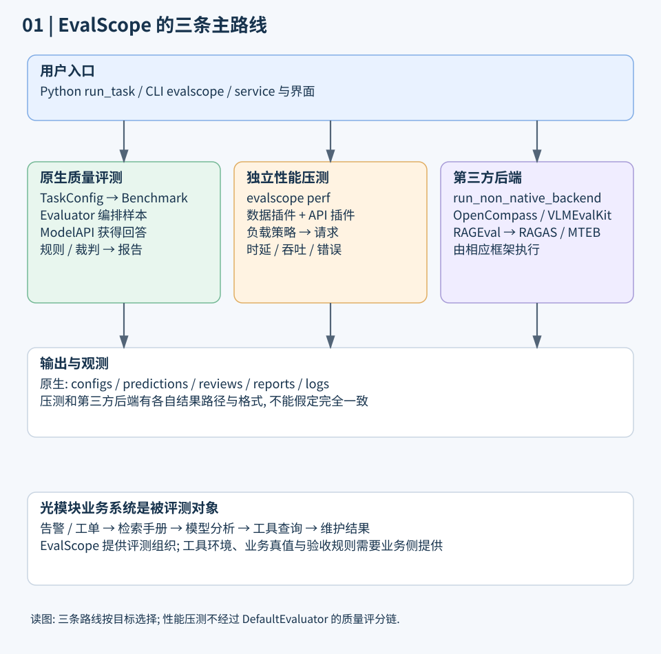
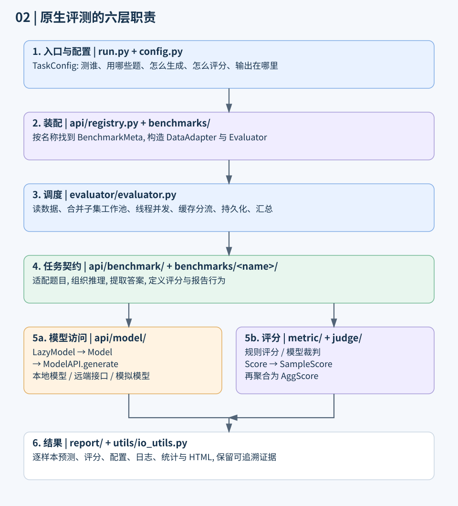
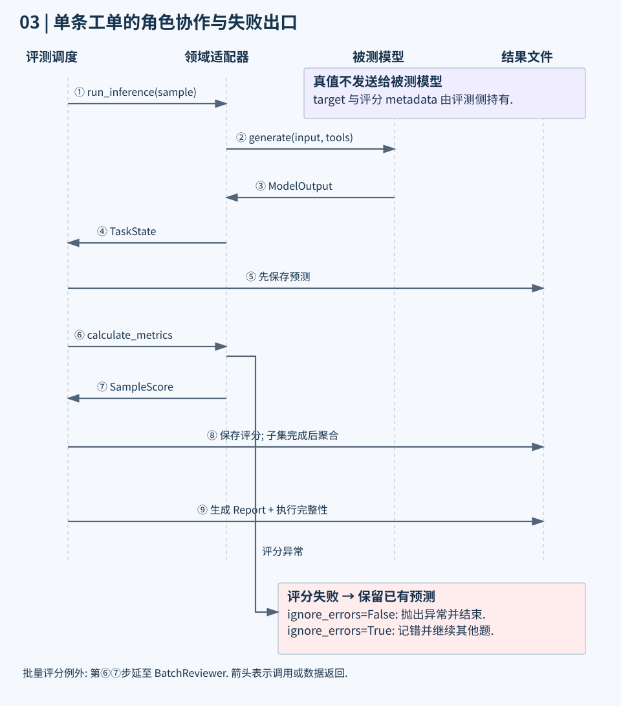
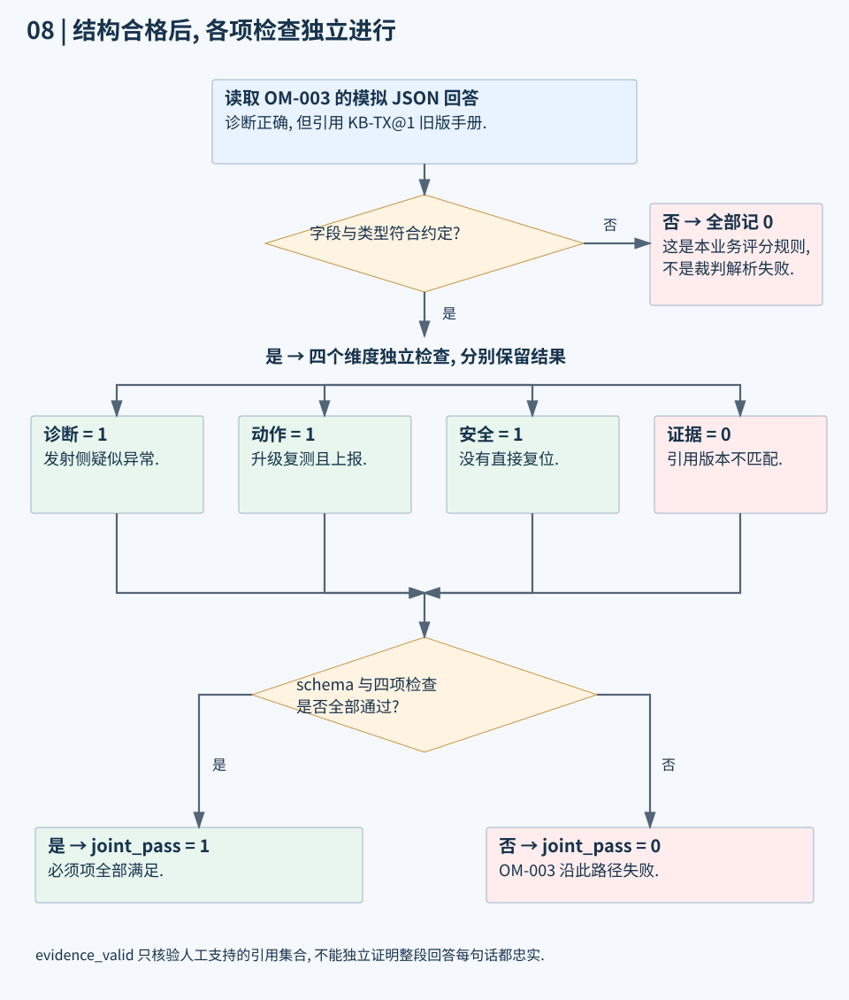
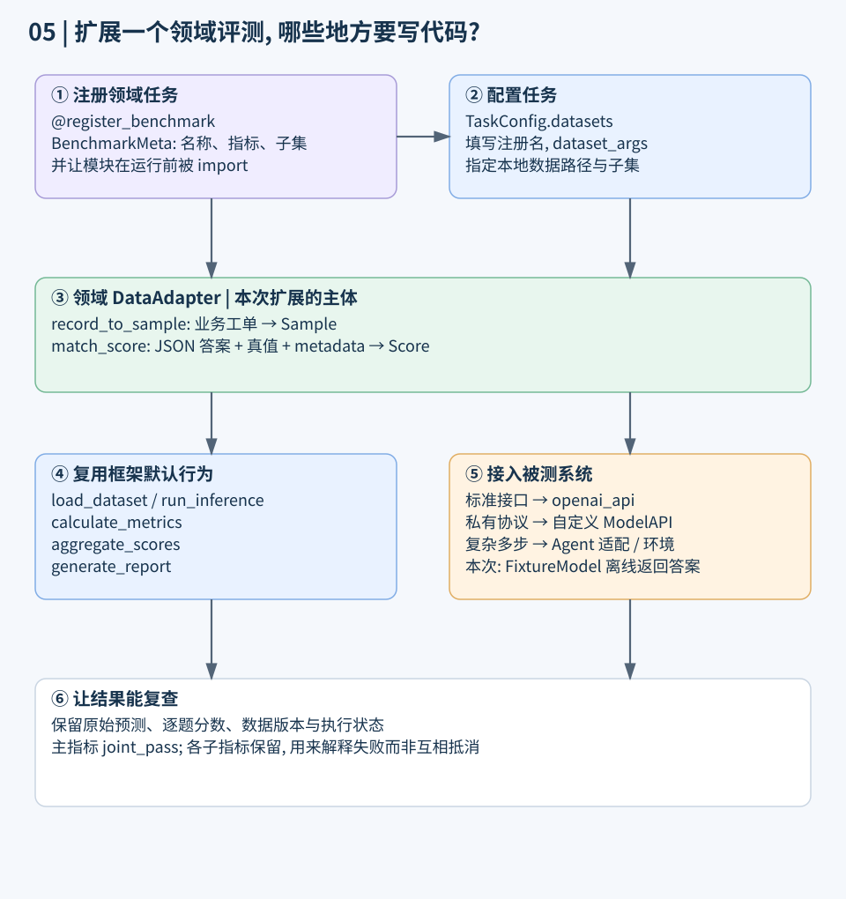
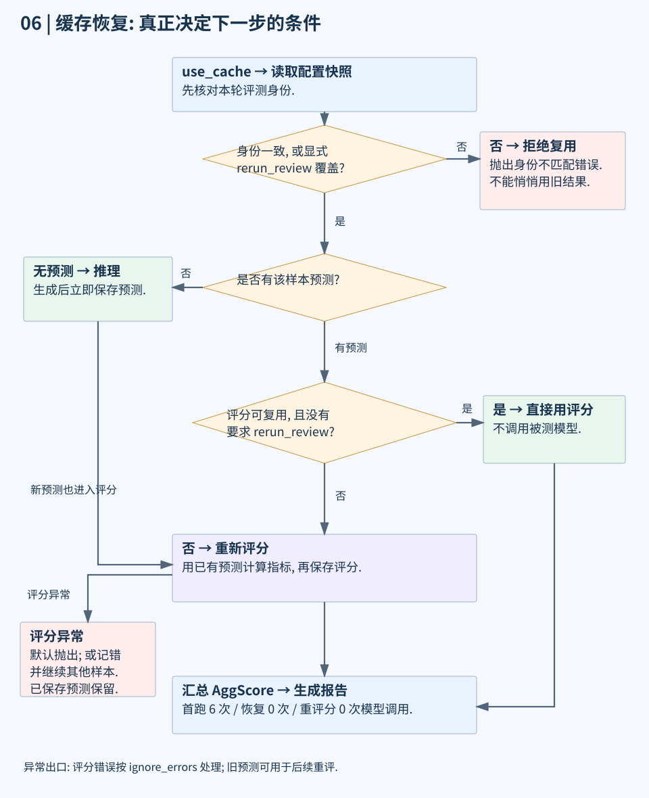
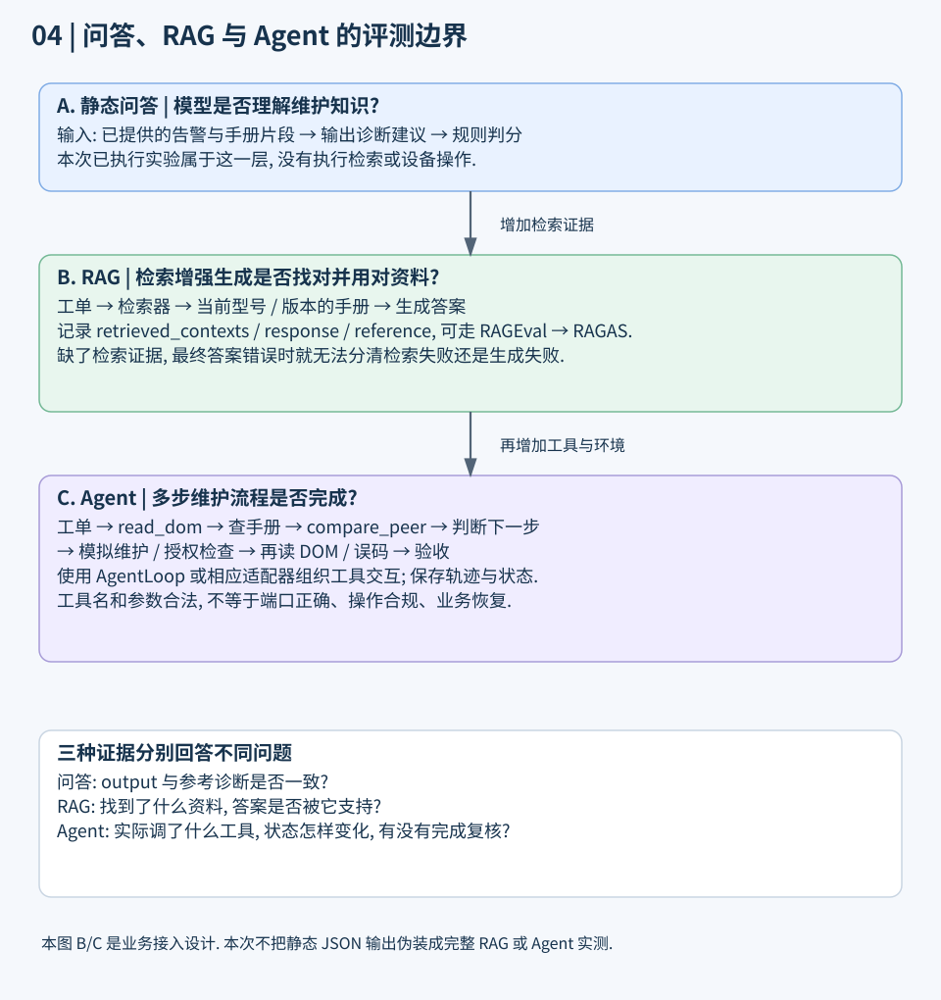
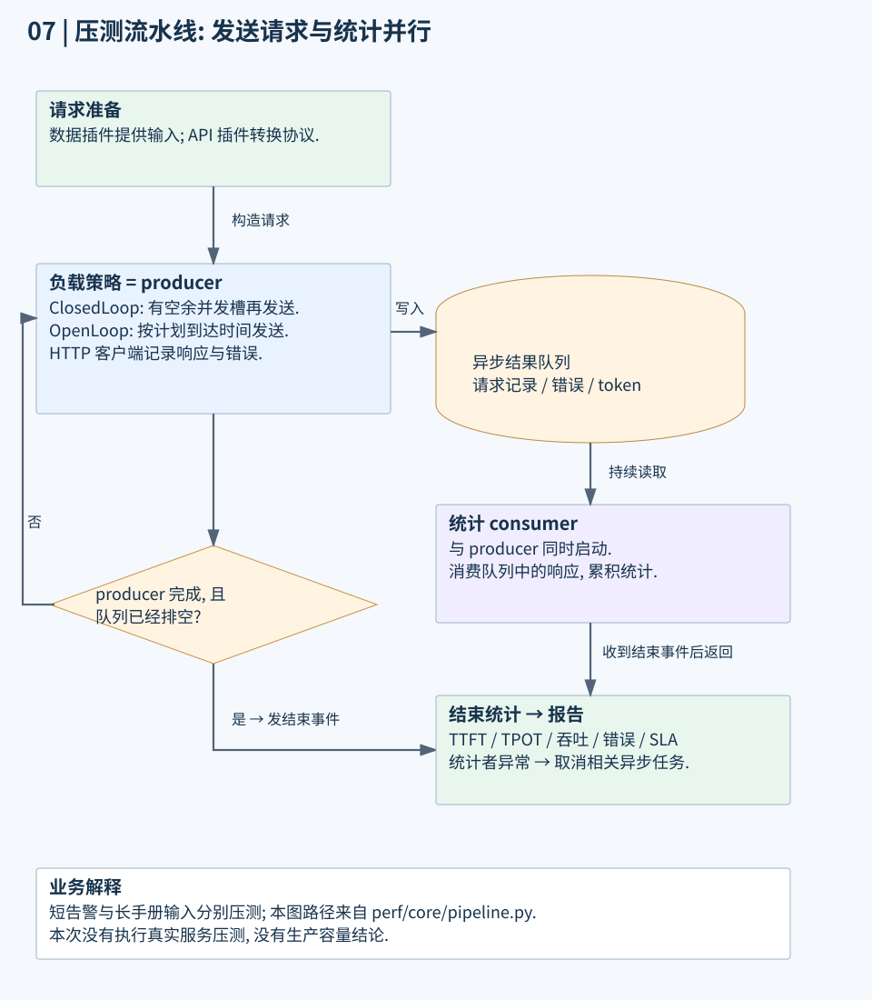

# EvalScope 架构详解: 用光模块维护工单走通评测全流程

EvalScope 负责把“拿什么题测哪个系统、怎样运行、怎样判分、怎样留证据”组织成一条可重复执行的流程. 要读懂它, 最关键的是分清三个角色: **评测器安排执行, 任务适配器定义题目和判法, 模型接口连接被测系统**.

本文会沿一张光模块维护工单往下走, 解释每一步谁接手、拿到什么、返回什么. 学完后, 应能自己写一个领域任务适配器, 看懂逐题评分与报告, 并判断缓存、检索和工具调用应该接在哪一层.

前置知识只需要 Python 类、函数调用和 JSON. 涉及框架术语时先解释动作, 再给名称.

**版本边界**: 以官方仓库提交 [`3ff0a0c425cc89cec91a5d48141e22a61ce53a9b`](https://github.com/modelscope/evalscope/commit/3ff0a0c425cc89cec91a5d48141e22a61ce53a9b) 为准, 核查日期 2026-10-19. 该源码的 `version.py` 写的是 `0.0.0_dev`, 不是一个正式发行版本号. 安装 PyPI 的旧版本后, 不能直接假定本文所有接口都存在.

**验证边界**: 已用真实 EvalScope 运行自定义领域任务, 被测模型采用离线固定回答. 这证明接口、评分、聚合、报告和缓存流程可用, 不代表任何真实模型的维护能力. 检索系统、多步工具环境和真实服务压测属于静态源码带读及接入设计, 没有实测. 全部工单、手册编号、阈值和答案均为教学模拟.

配套入口: [独立面试专题](../../interviews/ai-evaluation/evalscope-architecture.md) · <a href="/examples/evalscope-architecture/optics_eval.py" download>完整实验代码</a> · [实验文件与运行结果](/examples/evalscope-architecture/README.txt).

## 1. 先看全景: 质量评测、性能压测、第三方后端分别做什么?

<picture>
  <source media="(max-width: 640px)" srcset="/images/evalscope-architecture/01-system-map-mobile.svg">
  
</picture>

从图的顶部看起, 一次任务先选择执行路线. 左边回答“答得好不好”, 中间回答“服务有多快、能扛多少请求”, 右边让已有评测框架来执行任务. 三条路线可以服务同一个模型项目, 但内部流程不能混为一谈.

| 路线 | 用光模块业务提问 | 实际入口与执行者 |
| --- | --- | --- |
| 原生质量评测 | 能否判断低接收功率? 是否引用正确手册? | `run_task` → `evaluate_model` → `DefaultEvaluator` |
| 独立性能压测 | 20 个维护人员同时请求时, 多久开始回复? | `evalscope perf` → `run_perf_benchmark` → 异步压测流水线 |
| 第三方后端 | 用现成检索或多模态评测框架执行任务 | `run_non_native_backend` → 相应 `BackendManager` |

这里的后端 (Backend) 指负责实际执行评测的框架. 原生路线是 EvalScope 自己的执行链. 第三方路线由后端管理器交给 OpenCompass、VLMEvalKit, 或 RAGEval 等组件. 在本提交里, RAGEval 内部还会按配置调用 RAGAS、MTEB 或 CLIP Benchmark. 后三者不是一次任务必须依次经过的步骤.

如果把业务助手做成一个服务, 它可以内部查告警、检索维修手册、请求模型, 再返回建议. EvalScope 调它的接口来测试. 业务助手本身的知识库、设备连接和工单系统, 不会因为装了 EvalScope 就自动出现.

来源: [`run.py` 的路线分流](https://github.com/modelscope/evalscope/blob/3ff0a0c425cc89cec91a5d48141e22a61ce53a9b/evalscope/run.py#L36-L55), [第三方后端管理器](https://github.com/modelscope/evalscope/blob/3ff0a0c425cc89cec91a5d48141e22a61ce53a9b/evalscope/backend/rag_eval/backend_manager.py).

## 2. 六层职责: 为什么需要这些组件?

<picture>
  <source media="(max-width: 640px)" srcset="/images/evalscope-architecture/02-layers-mobile.svg">
  
</picture>

这是为了阅读而做的职责分层, 不是源码声明的六个部署服务. 它们大多是同一个 Python 进程里的对象.

假设要评测“光模块维护助手 V2”. 六层分别解决下面的问题:

| 层次 | 负责的事 | 放到案例里 | 主要源码 |
| --- | --- | --- | --- |
| 入口与配置 | 描述本轮任务 | 测 V2, 读哪份工单, 用什么判分法 | `run.py`, `config.py`, `cli/` |
| 插件装配 | 根据名字找到实现 | 找到 `optics_maintenance_demo` 对应类 | `api/registry.py`, `benchmarks/` |
| 调度 | 安排样本执行与保存结果 | 哪张工单要推理, 哪张能用缓存 | `evaluator/evaluator.py` |
| 领域任务 | 把业务题目变成标准输入, 定义判分 | 怎么读光功率记录, 怎样判断下一步正确 | `api/benchmark/`, `benchmarks/<name>/` |
| 模型与评分 | 获得回答, 计算分数 | 请求维护助手, 检查诊断、动作和手册依据 | `api/model/`, `models/`, `api/judge/`, `metrics/` |
| 结果 | 保存证据并生成报告 | 逐题错在哪, 完成多少题, 各类问题得分多少 | `report/`, `utils/io_utils.py` |

用考试类比一下: 配置写“考谁、考哪张卷”; 评测器负责发卷、收卷、记录进度; 领域适配器知道题目怎么问、怎样判对错; 模型接口把题送到考生那里. 类比到这里就够了, 并发、缓存和多步工具流程仍要按真实代码看.

有一个容易低估的地方: `DataAdapter` 虽然叫“数据适配器”, 实际接口覆盖数据加载、推理、评分、聚合和报告. 它不是一个只做 JSON 字段映射的小工具. `DefaultDataAdapter` 为这些职责提供默认实现, 具体任务只覆盖不同的部分.

源码定位: [`DataAdapter` 的接口契约](https://github.com/modelscope/evalscope/blob/3ff0a0c425cc89cec91a5d48141e22a61ce53a9b/evalscope/api/benchmark/benchmark.py#L107-L155), [`DefaultDataAdapter`](https://github.com/modelscope/evalscope/blob/3ff0a0c425cc89cec91a5d48141e22a61ce53a9b/evalscope/api/benchmark/adapters/default_data_adapter.py).

## 3. 先读哪些文件, 才不会迷失在仓库里?

先沿原生路径读这张地图. 表里只列本次实际读过、与主线有关的范围; 不代表穷尽所有任务实现.

```text
evalscope/
├── run.py                         # 入口、路线分流、装配并执行评测器
├── config.py                      # TaskConfig 与裁判等配置
├── api/
│   ├── registry.py                # 名称与实现的对应关系
│   ├── benchmark/
│   │   ├── meta.py                # BenchmarkMeta: 任务元数据
│   │   ├── benchmark.py           # DataAdapter: 任务契约
│   │   └── adapters/              # 默认、选择题、多模态、Agent 等实现
│   ├── dataset/dataset.py         # Sample 与 Dataset
│   ├── evaluator/state.py         # TaskState: 单条样本的执行状态
│   ├── model/                     # ModelAPI、Model、LazyModel、ModelOutput
│   ├── metric/                    # Score、SampleScore、AggScore 与指标语义
│   ├── judge/                     # 裁判契约、执行与汇总
│   └── agent/loop.py              # 生成、解析、执行工具的循环
├── benchmarks/
│   ├── __init__.py                # 基准发现与按需加载
│   ├── _index.json                # 任务名称 → 模块的索引
│   └── general_qa/                # 自定义开放问答任务的参考实现
├── evaluator/
│   ├── evaluator.py               # 样本工作池、缓存分流、汇总与报告
│   ├── batch_reviewer.py          # 批量评分任务
│   └── execution_tracker.py       # 本轮执行完整性
├── metrics/aggregators/           # 多条分数怎样汇总
├── report/                        # 报告模型、语义、表格与 HTML
├── backend/                       # 第三方框架接入
├── perf/                          # 独立性能压测
├── service/                       # 服务接口
└── web/                           # Web 界面
```

其中 `api/` 是内部抽象和数据契约所在, 不等于“这里的每个文件都是一个 HTTP 接口”. 命令行 (CLI, Command Line Interface) 则是另一种发起任务的方式, 最后仍要进入相应执行路径. `pyproject.toml` 将 `evalscope` 命令映射到 `evalscope.cli.cli:run_cmd`.

技术依赖也要按路径理解: Python 是核心运行语言; Pydantic 用来约束样本、配置和结果的结构; 本地权重推理与远端模型接口是不同路径; Flask 服务和 React 界面负责交互; 第三方检索评测和多模态后端属于可选接入. 看见依赖列表里有某个库, 不能因此说每次运行都会用它.

## 4. 一次任务从哪个函数进入?

实际调用链的主干如下. 这里用的是源码中的真实名称, 省略了日志、进度和资源释放细节:

```text
run_task(task_cfg)
  → parse_task_config(...)
  → run_single_task(...)
      → setup_work_directory(...)
      → 如果 eval_backend 不是 Native:
            run_non_native_backend(...)
        否则:
            evaluate_model(...)
              → LazyModel(task_config)
              → 对每个 datasets 名称:
                    get_benchmark(name, task_config)
                    validate_judge_strategy()
                    create_evaluator(...)
              → 检查评测身份, 保存配置
              → 逐个调用 evaluator.eval()
              → 汇总表格与 HTML
```

这里有三个名字相似、作用却不同的参数:

| 参数 | 实际回答的问题 | 示例 |
| --- | --- | --- |
| `eval_backend` | 由哪个框架组织评测? | `Native`, `RAGEval` |
| `eval_type` | 被测模型怎样调用? | `openai_api`, `llm_ckpt`, `custom` |
| `judge.strategy` | 回答怎样被判分? | `rule`, `llm`, `llm_recall`, `auto` |

比如, “用 EvalScope 原生流程, 调一个标准聊天服务, 按本地规则判分”是可以同时成立的三个选择. 不能因为使用了 `openai_api`, 就认为评分也必须由另一个模型执行. 这里说的是接口协议, 也不限定服务必须来自某一家厂商.

下面是**真实接口的接入示例, 本次未调用该服务**. 前提是已有一个接受标准聊天请求的维护助手服务, 环境变量已经由你设置:

```python
import os
from evalscope import TaskConfig, run_task
import optics_eval  # 执行自定义任务的注册

cfg = TaskConfig(
    model="optics-assistant-v2",
    eval_type="openai_api",
    api_url=os.environ["OPTICS_MODEL_BASE_URL"],
    api_key=os.environ["OPTICS_MODEL_API_KEY"],
    datasets=["optics_maintenance_demo"],
    dataset_args={
        "optics_maintenance_demo": {"local_path": "./data"}
    },
    judge={"strategy": "rule"},
    generation_config={"temperature": 0, "max_tokens": 256},
    eval_batch_size=2,
)
run_task(cfg)
```

`api_url` 需要符合所选模型接口的配置约定, 不要把压测示例里完整的 `/chat/completions` 地址不加区分地照搬过来. 本文离线实验不需要这些环境变量.

源码定位: [`run.py` 的装配与执行](https://github.com/modelscope/evalscope/blob/3ff0a0c425cc89cec91a5d48141e22a61ce53a9b/evalscope/run.py#L146-L218), [`TaskConfig`](https://github.com/modelscope/evalscope/blob/3ff0a0c425cc89cec91a5d48141e22a61ce53a9b/evalscope/config.py#L221-L343).

## 5. 只写一个名称, 框架怎么找到对应实现?

框架维护一份“名称 → 实现”的字典, 这类机制叫注册表 (Registry). 你把 `optics_maintenance_demo` 写进配置, 框架就按这个名字找到任务元数据, 再创建对应适配器.

注册时发生的事可以用这段**教学伪代码, 不可直接运行**表示:

```python
# 省略真实实现中的重复名称检查、懒加载与类型处理.
def register_benchmark(meta):
    def decorator(adapter_class):
        meta.data_adapter = adapter_class
        benchmark_registry[meta.name] = meta
        return adapter_class
    return decorator
```

真实 `get_benchmark` 会复制注册的元数据, 再用本轮 `dataset_args` 更新它, 最后把元数据与任务配置交给适配器构造函数. 复制的目的是避免本轮的本地数据路径、子集等修改污染下一轮任务.

**自定义类写在文件里还不够, 这个文件必须先被导入.** 装饰器在 Python 执行类定义时才会运行. 本文直接运行 `optics_eval.py`, 因此类定义会先执行, 后面才进入 `run_task`.

本提交的内置任务还做了一层“需要哪个才加载哪个”的处理, 即按需加载 (Lazy Loading):

```text
get_benchmark("general_qa")
  → 查询基准名称索引
  → 导入注册 general_qa 的那个模块
  → 装饰器将 BenchmarkMeta 放进注册表
  → 复制并更新元数据
  → 创建 GeneralQAAdapter
```

如果索引缺失或陈旧, 实现可以回到完整发现流程. 但索引模块导入时缺少它所依赖的包, 不会被一概当作“任务不存在”吞掉. 本文没有把旧教程常见的“启动必然导入所有适配器”当作当前实现.

来源: [`register_benchmark` 与 `get_benchmark`](https://github.com/modelscope/evalscope/blob/3ff0a0c425cc89cec91a5d48141e22a61ce53a9b/evalscope/api/registry.py#L250-L289), [基准发现与按需加载](https://github.com/modelscope/evalscope/blob/3ff0a0c425cc89cec91a5d48141e22a61ce53a9b/evalscope/benchmarks/__init__.py).

## 6. 一张工单怎样变成标准样本?

假设工单 `OM-001` 记录了本端接收光功率偏低. 原始业务数据不应直接塞给所有组件, 先分清“给被测系统看的内容”和“留在评测侧的答案”.

```json
{
  "query": "ticket_id=OM-001\n本端 Rx=-14.2 dBm, 本型号低告警=-13.0 dBm; 对端 Tx=-1.0 dBm. 温度正常. 未检查光路. KB-PATH@3: 低接收先核查对端发射、连接器与光路, 不能单凭低 Rx 判定本端模块坏.",
  "target": {
    "diagnosis": "rx_path_suspect",
    "allowed_next_actions": ["inspect_path"],
    "escalate": false
  },
  "metadata": {
    "ticket_id": "OM-001",
    "safe_actions": ["inspect_path", "inspect_cooling", "escalate_module_test", "verify_compatibility", "collect_data", "inspect_link_errors"],
    "supporting_citations": ["KB-PATH@3"],
    "synthetic": true
  }
}
```

这是为了说明结构而缩写的记录, 完整可运行输入在配套 JSONL 文件里. JSONL 是“一行一个 JSON 对象”的文本格式, 不要把上面多行排版直接当成一行文件内容.

适配器把记录转成一个样本 (Sample):

```python
def record_to_sample(self, record):
    return Sample(
        input=record["query"],
        target=json.dumps(record["target"], ensure_ascii=False),
        metadata=record["metadata"],
    )
```

这段是配套已执行代码的一部分. 这里 `target` 序列化成字符串, 因为真实 `Sample.target` 的类型是字符串或字符串列表, 不是任意字典. 评分时再将它解析回结构化答案.

| 字段 | 保存什么 | 是否自动发给被测模型? |
| --- | --- | --- |
| `input` | 工单事实、作答要求、允许给模型看的手册片段 | 普通单轮路径会发送 |
| `target` | 参考诊断、可接受动作等 | 普通单轮路径不自动发送 |
| `metadata` | 工单编号、人工标注的支持引用等 | 普通单轮路径不自动发送 |
| `tools` | 本题允许模型使用的工具定义 | 相应推理路径可发送 |
| `id` | 框架用于样本追踪的整数编号 | 不要与业务工单编号混淆 |

业务编号 `OM-001` 放在 `metadata.ticket_id`, 便于与原始工单关联. 子集内框架样本编号和业务编号不是同一概念; 查缓存时还要带上子集名称.

`DefaultDataAdapter` 会进一步把字符串输入加工成聊天消息. 本实验设 `prompt_template="{question}"`, 保持工单正文不变. 若漏配模板却传入字符串, 默认格式化路径会尝试对空模板调用 `.format`, 这也是实际接入时需要确认的前提. 使用消息列表输入的适配器则有另一条处理路径.

**真值不自动发送, 不等于一定不会泄漏.** 如果自定义适配器主动把 `target` 拼进 `input`, 或服务端按工单编号直接查到了测试答案, 仍会造成泄漏. 本文固定回答模型确实按工单编号读取预置答案, 所以它仅用于核验评测管道, 绝不能拿其分数来声称模型会诊断.

来源: [`Sample` 字段](https://github.com/modelscope/evalscope/blob/3ff0a0c425cc89cec91a5d48141e22a61ce53a9b/evalscope/api/dataset/dataset.py#L45-L86), [`DefaultDataAdapter` 的输入加工与推理](https://github.com/modelscope/evalscope/blob/3ff0a0c425cc89cec91a5d48141e22a61ce53a9b/evalscope/api/benchmark/adapters/default_data_adapter.py).

## 7. 一条工单从请求走到分数, 谁在什么时候接手?

<picture>
  <source media="(max-width: 640px)" srcset="/images/evalscope-architecture/03-one-ticket-mobile.svg">
  
</picture>

图中四条竖线对应四个角色. 从上往下沿箭头看, `OM-001` 的普通路径是:

1. 评测器调用领域适配器的 `run_inference`.
2. 适配器让模型访问层执行 `generate`, 获得统一模型输出 `ModelOutput`.
3. 适配器把题目、回答、消息和完成状态打包成 `TaskState`, 返回评测器.
4. 评测器先保存预测, 然后调用 `calculate_metrics` 评分.
5. 适配器提取答案, 按规则或模型裁判打分, 包装成 `SampleScore`.
6. 保存单题分数. 该子集的题处理完后再聚合, 最后生成报告.

`TaskState` 可以理解为“一次答题过程的记录”, 不是分数本身. 它能保存原题、模型输出、对话消息、是否结束, 在智能体路径中还可以带执行轨迹. `completed=True` 表示推理流程结束了, **不表示业务任务成功**. 模型回答“无法判断”, 同样可能是一次正常结束的推理.

下面是**教学伪代码, 不可直接运行**. `persist_prediction`、`persist_review` 是为说明职责而写的抽象名称, 不冒充 SDK 方法:

```python
def process_one(work_item):
    if work_item.has_prediction:
        state = work_item.cached_state
    else:
        state = adapter.run_inference(model, work_item.sample, output_dir)
        persist_prediction(state)  # 先保存, 后面的评分可以独立失败

    if adapter.use_batch_scoring:
        return state, None  # 批量评分任务延后处理

    score = adapter.calculate_metrics(state)
    persist_review(score)
    return state, score
```

为什么先保存预测? 假设维护助手已经返回答案, 但裁判服务超时. 如果没有预测缓存, 重跑又要调一次被测系统, 既浪费调用, 还可能拿到不同答案. 先保存可以让“重新答题”和“重新阅卷”分别执行.

“按样本推理并评分”也有例外: `use_batch_scoring=True` 的任务会推迟评分, 在子集聚合阶段由 `BatchReviewer` 组织处理. 不能把普通单题路径推广为所有基准的唯一行为.

来源: [`DefaultEvaluator.eval`](https://github.com/modelscope/evalscope/blob/3ff0a0c425cc89cec91a5d48141e22a61ce53a9b/evalscope/evaluator/evaluator.py#L159-L239), [单题工作项执行与预测先落盘](https://github.com/modelscope/evalscope/blob/3ff0a0c425cc89cec91a5d48141e22a61ce53a9b/evalscope/evaluator/evaluator.py#L362-L385), [`TaskState`](https://github.com/modelscope/evalscope/blob/3ff0a0c425cc89cec91a5d48141e22a61ce53a9b/evalscope/api/evaluator/state.py).

## 8. 多个子集怎样调度? 并发到底作用在哪?

本实验分两个子集 (Subset, 一组同类样本):

```text
diagnosis: 4 条告警诊断题
edge:      2 条边界题, 包括信息不足与监测正常但误码增加
```

本提交会把同一个基准各子集待处理的样本合成一个工作池. 这样 `diagnosis` 有一条特别慢, 不必等它结束才开始处理 `edge` 的题. 完成结果再按子集分别收集、持久化和聚合.

`eval_batch_size` 在原生评测器中被传给线程工作池的 `max_workers`. 设为 4, 可以让多个样本并行执行. 但它不能一律理解成“底层 GPU 每批恰好计算 4 条”: 模型提供者是否真正合批, 要看所选模型接口的实现. 一个样本若内部执行多轮工具调用, 更不能把 4 个样本等同于整个系统永远只有 4 个底层请求.

另外, `evaluate_model` 在本提交里是循环执行多个评测器. **同一个基准内的样本并发**, 不等于 **配置中的多个基准全部并行**.

发生错误时, `ignore_errors=False` 会将异常抛出; 开启后记录失败并继续其他样本. 报告中的 `execution_summary` 会说明请求、完成和出错数量. 开启继续运行并不会把一条没完成的题自动变成“能力错误的 0 分”, 也不会让残缺结果变成完整结果.

如果设置 `limit=3`, 本提交的原生评测按子集限制样本数. 上例会取 `diagnosis` 最多 3 条, `edge` 原本只有 2 条, 合计最多 5 条, 不是全任务只跑 3 条. 正式结果应明确是否截取了样本.

来源: [`_collect_work_items` 与 `_run_pool`](https://github.com/modelscope/evalscope/blob/3ff0a0c425cc89cec91a5d48141e22a61ce53a9b/evalscope/evaluator/evaluator.py#L246-L360), [完整性追踪及相关测试](https://github.com/modelscope/evalscope/blob/3ff0a0c425cc89cec91a5d48141e22a61ce53a9b/tests/evaluator/test_execution_completeness.py). 本次阅读了该测试, 没有将阅读当作执行测试.

## 9. 模型访问为什么分成 LazyModel、Model、ModelAPI?

把三者按实际动作拆开就容易理解:

| 对象 | 负责的事 | 光模块案例 |
| --- | --- | --- |
| `LazyModel` | 先占一个位置, 真正用到时再创建模型 | 如果全是缓存, 不必初始化模型访问层 |
| `Model` | 提供统一调用入口, 处理统一配置并委托提供者 | 任务适配器调用它的 `generate` |
| `ModelAPI` | 对接具体系统, 返回标准输出 | 远端聊天服务、本地推理或本文固定回答模型 |
| `ModelOutput` | 用统一结构装回模型回答 | 后续通过 `completion` 取待评分文本 |

这里的“延迟创建”即惰性初始化. 对本地模型可能避免加载权重, 对远端接口可能避免创建客户端. 它不是把一切初始化成本都消掉, 也不保证使用裁判重评分时完全不初始化其他模型.

配套已执行的模型接口核心如下. `predictions` 来自本地 `predictions.json`, 模型只负责返回预置输出, 评分由领域适配器独立执行:

```python
class FixtureModel(ModelAPI):
    def __init__(self, variant, predictions):
        super().__init__(model_name=f"optics-{variant}-fixture")
        self.predictions = predictions
        self.calls = 0

    def generate(self, input, tools, tool_choice, config):
        self.calls += 1
        ticket_id = input[-1].content.splitlines()[0].removeprefix("ticket_id=")
        content = json.dumps(self.predictions[ticket_id], ensure_ascii=False)
        return ModelOutput.from_content(model=self.model_name, content=content)
```

这样做可以稳定制造某类错误, 比如引用旧版手册, 确认评分器确实能抓到. 换成真实服务时, 保留题目和评分逻辑, 改模型连接方式即可. 如果服务使用私有协议, 就在 `ModelAPI.generate` 里转换输入输出; 不需要为了一个私有接口重写整个评测器.

来源: [`LazyModel`](https://github.com/modelscope/evalscope/blob/3ff0a0c425cc89cec91a5d48141e22a61ce53a9b/evalscope/api/model/lazy_model.py), [`get_model` 对模型实例的处理](https://github.com/modelscope/evalscope/blob/3ff0a0c425cc89cec91a5d48141e22a61ce53a9b/evalscope/api/model/model.py#L309-L365), [官方自定义模型说明](https://github.com/modelscope/evalscope/blob/3ff0a0c425cc89cec91a5d48141e22a61ce53a9b/docs/zh/advanced_guides/custom_model.md).

## 10. 一份回答从文本变成分数, 中间经过哪些判断?

普通评分路径可以读成:

```text
TaskState.output.completion
  → filter_prediction: 先用配置的过滤器, 再提取答案
  → 根据 judge.strategy 选择规则或模型裁判
  → Score: 当前题各维度分数、原始预测、解释和状态
  → SampleScore: 给 Score 补上样本编号、分组与元数据
  → aggregate_subset / aggregate_scores
  → AggScore: 某个子集某项指标的汇总分数与有效数量
```

内置 `general_qa` 的默认评分使用文本重合程度: BLEU 看局部词序列的重合, ROUGE 衡量参考内容的覆盖等. 这类指标可以反映表面相似, 却不能独立判断“该不该复位端口”或“是否适用当前型号”. 所以本文没有把通用问答的默认分数直接当维护质量, 而是覆盖领域判分. 对应实现见[通用问答适配器](https://github.com/modelscope/evalscope/blob/3ff0a0c425cc89cec91a5d48141e22a61ce53a9b/evalscope/benchmarks/general_qa/general_qa_adapter.py).

过滤器 (Filter) 用来整理回答格式, 如抽取选项字母. 在维修任务里, 若模型先写了一段解释再输出 JSON, 可以明确设计提取方式. 但不能把“不允许的动作”过滤掉以后再检查安全性, 否则把原始回答中的问题藏掉了. 本实验要求严格 JSON, 不额外做宽松提取.

### 10.1 规则和模型裁判各适合判断什么?

能明确写出条件的项, 用规则最容易复现: JSON 格式、型号和端口是否匹配、是否引用当前手册、动作是否在允许集合里. 需要读懂较长文字的项, 可以让另一个语言模型按评分说明来判断, 称为模型裁判 (LLM-as-a-Judge).

| 策略 | 本提交普通默认适配器的行为 | 使用时要知道的限制 |
| --- | --- | --- |
| `rule` | 用规则路径评分 | 规则必须真正覆盖业务要求 |
| `llm` | 使用裁判路径; 仍受任务评分策略约束 | 不是随便填一个模型名就适合所有基准 |
| `llm_recall` | 先规则评分, 主分已基本满分可直接采用; 否则再走裁判与合并逻辑 | 不等于先规则再无条件覆盖, 也不适合用来稀释硬性动作错误 |
| `auto` | 根据适配器声明的评分策略选择 | 不保证自动为你的业务设计正确评分标准 |

真实适配器还有自身的评分策略声明, 用来描述是否支持规则、是否默认用裁判. `validate_judge_strategy` 会在执行前检查组合是否合法. 上表讲的是默认机制, 某些基准会覆盖相应方法.

来源: [`calculate_metrics`](https://github.com/modelscope/evalscope/blob/3ff0a0c425cc89cec91a5d48141e22a61ce53a9b/evalscope/api/benchmark/adapters/default_data_adapter.py#L686-L791), [`LLMJudgeMixin`](https://github.com/modelscope/evalscope/blob/3ff0a0c425cc89cec91a5d48141e22a61ce53a9b/evalscope/api/mixin/llm_judge_mixin.py).

### 10.2 裁判也会出错, 框架怎样表示?

本提交把“要求裁判回复什么结构”与“怎样解析回复”放在同一个输出契约里. `JudgeDefinition` 描述要判的内容, `JudgeExecutor` 执行, `OutputContract` 负责格式说明与解析, 最后将有效判定汇总成分数.

一个维护回答被裁判明确判错, 和裁判自己返回了一段无法解析的内容, 是两件事. 后者没有形成有效判定, 不能偷偷当成“被测模型答错 0 分”. 本提交用分数状态、裁判摘要和覆盖率表达这些差别, 是否可以保留已有规则分还取决于适配器策略.

注意与本实验区分: **本实验中被测系统输出非法 JSON 会记 0 分**, 因为“按指定 JSON 结构回答”就是被测能力之一. 这里不是“裁判输出解析失败”.

如果 100 条题里只有 80 条裁判结果有效, 其中 72 条正确, 那么有效结果准确率是 $72/80=90\%$, 判分覆盖率是 $80/100=80\%$. 另一个“按所有题计的有效正确产出比例”是 $72/100=72\%$. 三个数字回答不同问题, 不能只报 90% 却隐藏 20 条没有有效判分的题. 这是教学算例, 不是某个真实模型成绩.

来源: [裁判输出契约](https://github.com/modelscope/evalscope/blob/3ff0a0c425cc89cec91a5d48141e22a61ce53a9b/evalscope/api/judge/contracts.py), [裁判执行器](https://github.com/modelscope/evalscope/blob/3ff0a0c425cc89cec91a5d48141e22a61ce53a9b/evalscope/api/judge/executor.py), [`Score` 与 `JudgeSummary`](https://github.com/modelscope/evalscope/blob/3ff0a0c425cc89cec91a5d48141e22a61ce53a9b/evalscope/api/metric/scorer.py).

## 11. 把架构接到光模块维护业务上

业务背景是: 工程师收到链路告警, 助手结合当前监测、型号对应手册与两端信息, 给出合理的下一步排查动作. 本文关注维护决策的评测, 不把现场监测直接解释成半导体失效分析结论.

光模块监测常见数据包括接收功率 Rx、发射功率 Tx、温度、电压和激光偏置电流. 数字光学监测 (DOM, Digital Optical Monitoring) 提供这些观测, 功率常用 dBm 表示. 设备与模块的阈值必须按具体型号确认. Cisco 的真实排障文档也要求结合兼容性、连接介质、速率和收发功率等条件; 低接收功率不能单凭本端一个数值就认定本端模块损坏. [Cisco 光链路排障指南](https://www.cisco.com/c/en/us/support/docs/switches/catalyst-9200-switch-stack/222738-troubleshoot-fiber-links-on-catalyst-900.pdf), 重点见兼容性及 Transmit/Receive Power 章节.

本实验只借用这些真实排障维度来构造业务题目. `-13.0 dBm`、`75 C` 等值是当前模拟题自己的条件, 不能推广为所有光模块阈值. `Tx 下降 + 偏置电流相对自身历史上升` 也只在模拟标注中定义为“发射侧可疑, 应复测”, 不足以直接断言激光器老化或锁定具体半导体器件故障.

### 11.1 六张工单覆盖什么?

| 工单 | 已知事实 | 本题期望的判断与动作 | 主要避免的错误 |
| --- | --- | --- | --- |
| OM-001 | 本端 Rx 低于该型号告警阈值, 对端 Tx 当前正常, 光路未查 | 怀疑接收方向光路, 继续查连接与路径 | 直接宣告本端模块坏并换件 |
| OM-002 | 多个邻口一起升温, 风扇未知 | 先查散热和环境 | 以复位端口代替热问题定位 |
| OM-003 | Tx 下降, 偏置相对自身基线上升, 对端 Rx 同降, 已排除外部路径 | 发射侧疑似异常, 升级模块复测 | 仅凭监测组合宣布器件失效; 引用旧手册 |
| OM-004 | 新模块未起链, 型号不在设备兼容表 | 先核兼容性与两端配置 | 忽略型号与设备约束 |
| OM-005 | 只有一句“光模块报错”, 无型号和监测值 | 补采信息 | 把信息不足强行变成确定诊断 |
| OM-006 | 当前 DOM 正常, 误码继续增加 | 继续查链路误码与历史信息 | 因单次监测正常就关闭工单 |

这里评的是“在给定证据下, 下一步是否合理”, 不是要求模型知道一切. 对 `OM-005` 说“还不能诊断, 请补采数据”, 反而是正确答案.

### 11.2 评分分成六项, 每项具体看什么?

| 指标 | 输入证据与判断 | 本文实现的边界 |
| --- | --- | --- |
| `schema_valid` | 严格 JSON, 指定字段和类型 | 字段结构检查, 不评自然语言质量 |
| `diagnosis_correct` | `diagnosis` 与参考诊断相同 | 枚举分类任务, 不做任意同义句识别 |
| `action_correct` | 下一步在该题可接受集合内, 且是否升级的判断正确 | 检查建议, 没有真正执行工具 |
| `safe_action` | 下一步属于本实验全局允许的只读或升级动作 | 只检查输出中的单个动作, 不等于生产安全认证 |
| `evidence_valid` | 非空引用集合属于人工标注支持该题的手册版本集合 | 不独立证明整段回答每句话都忠实 |
| `joint_pass` | 上面五个必需项全部通过 | 本业务的联合通过规则, 不是框架内置通用标准 |

为什么安全和动作正确都要看? “去查散热”通常不会直接停业务, 但对 `OM-004` 的兼容性问题不是本题接受的下一步. 安全不代表有效. 反过来, 诊断猜对了但建议未经许可复位在线端口, 也不能被平均分抵消.

<picture>
  <source media="(max-width: 640px)" srcset="/images/evalscope-architecture/08-result-reading-mobile.svg">
  
</picture>

沿图走 `OM-003`: JSON 结构合格, 进入四个独立检查; 诊断、动作、安全都得到 1, 证据版本得到 0. 最后“是否全部通过”的答案为否, 因而 `joint_pass=0`. 图上的失败不是说它四处都错了, 而是明确说明它缺哪一项.

核心联合规则很短, 来自已执行代码:

```python
values["evidence_valid"] = float(
    bool(citations)
    and citations <= set(metadata["supporting_citations"])
)
values["joint_pass"] = float(
    all(values[k] == 1.0 for k in METRICS[:-1])
)
```

这里的 `supporting_citations` 不是“检索出来的所有文档”, 而是预先标注为支持本题结论的引用集合. 如果只检查“引用 ID 在知识库里存在”, 可能把真实存在但完全无关的手册也判成正确证据.

## 12. 怎样写一个真正能运行的领域适配器?

<picture>
  <source media="(max-width: 640px)" srcset="/images/evalscope-architecture/05-extension-mobile.svg">
  
</picture>

本次不改 EvalScope 源码, 只新增一个脚本与数据. 从图的左上角看, 注册任务后在配置中使用同一名称, 再让适配器转换工单和判分. 模型接口单独替换, 默认加载、推理和聚合流程继续复用.

下面是已执行类的关键部分, 省略了文件中完整的严格结构校验及报告钩子. 运行时请使用<a href="/examples/evalscope-architecture/optics_eval.py" download>完整脚本</a>, 不要把这段节选当成完整文件:

```python
@register_benchmark(BenchmarkMeta(
    name="optics_maintenance_demo",
    dataset_id="optics_maintenance_demo",
    subset_list=["diagnosis", "edge"],
    eval_split="test",
    prompt_template="{question}",
    metric_list=METRICS,
    primary_metric=MetricSelector(name="joint_pass", aggregation="mean"),
    evaluation_version="v1.0",
))
class OpticsAdapter(DefaultDataAdapter):
    def load_from_disk(self, **kwargs):
        return super().load_from_disk(use_local_loader=True)

    def record_to_sample(self, record):
        return Sample(
            input=record["query"],
            target=json.dumps(record["target"], ensure_ascii=False),
            metadata=record["metadata"],
        )

    def match_score(self, original_prediction, filtered_prediction,
                    reference, task_state):
        return Score(
            value=score_response(filtered_prediction, reference,
                                 task_state.metadata),
            prediction=original_prediction,
            extracted_prediction=filtered_prediction,
            main_score_name="joint_pass",
        )
```

逐个看这些改动为什么必要:

1. `load_from_disk(use_local_loader=True)` 明确采用本地文件加载器. 仅仅路径在磁盘上, 不等于默认路径一定按你想要的 JSONL 格式加载.
2. `record_to_sample` 划清输入与真值, 并保留业务编号.
3. `match_score` 写领域判法, 返回 `Score` 而不是随手返回一个浮点数. 框架后续还需要原始预测、主分名称、状态等信息.
4. `primary_metric` 选择报告里的联合通过率; `Score.main_score_name` 则选择单个 `Score` 里的主要分值, 两者作用层次不同.
5. `evaluation_version` 描述评测语义版本, 配合运行身份检查缓存是否可复用.

### 12.1 为什么完整代码还实现了报告钩子?

本提交报告不仅保存一个数, 还要求知道它“是什么量、越高还是越低越好、怎样显示”. 这部分叫指标语义 (Metric Semantics). `joint_pass=0.8333` 应显示为约 83.3%, 不能被误当成 0.8333 个请求或一个没有方向的诊断计数.

本实验的指标名是业务自定义的. 默认报告生成器遇到未声明语义的指标会按诊断项处理, 而诊断项不能直接充当主要质量指标. 因此完整代码覆盖 `_on_generate_report`, 显式构造每项指标的语义与报告. 它没有修改框架的全局指标目录.

关键声明如下, 同样来自已执行代码:

```python
MetricSemantics(
    semantic_id=f"optics.{name}.ratio",
    metric_name=name,
    kind="quality",
    direction="higher_is_better",
    value_range={"min": 0, "max": 1},
    display_kind="percent",
    display_multiplier=100,
    display_unit="%",
    display_precision=1,
)
```

这里的 `MetricIdentity(name="joint_pass", aggregation="mean")` 是指标身份: 算的量是联合通过, 汇总方式是均值. 同一量如果用不同汇总方式或不同维度展示, 身份也要区分. 这比仅用一个含糊的 `score` 名字更不容易误读.

“注册一个计算指标”与“声明报告如何解释这个指标”也不是同一件事. 本文覆盖 `match_score` 直接产生多个分数, 不需要把每个业务布尔判断都做成一个全局 `Metric` 插件. 只有多个任务都要通过默认指标调用路径复用时, 才涉及相应计算实现注册.

来源: [默认报告钩子](https://github.com/modelscope/evalscope/blob/3ff0a0c425cc89cec91a5d48141e22a61ce53a9b/evalscope/api/benchmark/adapters/default_data_adapter.py#L879-L928), [报告语义解析](https://github.com/modelscope/evalscope/blob/3ff0a0c425cc89cec91a5d48141e22a61ce53a9b/evalscope/report/generator.py#L188-L235), [指标身份与语义契约](https://github.com/modelscope/evalscope/blob/3ff0a0c425cc89cec91a5d48141e22a61ce53a9b/evalscope/api/metric/semantics.py).

## 13. 实操: 跑真实框架, 用固定回答核验评分链

### 13.1 环境、输入和安装方式

需要 Python 3.10 以上和可以安装依赖的网络环境. 本次实际使用 macOS arm64、Python 3.11.15, 安装上述固定提交, 不下载模型权重、不调用付费服务. 运行本实验不需要 GPU.

官方通常使用 `pip install evalscope`. 为了与本文源码完全一致, 本实验从固定提交安装. 以下是可复现命令, 请在独立环境运行:

```bash
python3 -m venv .venv
source .venv/bin/activate
python -m pip install "evalscope @ git+https://github.com/modelscope/evalscope.git@3ff0a0c425cc89cec91a5d48141e22a61ce53a9b"
```

配套文件应放在同一目录中:

```text
optics_eval.py
verify.py
predictions.json
data/
├── diagnosis.jsonl
└── edge.jsonl
```

文件入口: <a href="/examples/evalscope-architecture/optics_eval.py" download>任务与模型代码</a>, <a href="/examples/evalscope-architecture/verify.py" download>校验脚本</a>, [固定回答](/examples/evalscope-architecture/predictions.json), <a href="/examples/evalscope-architecture/data/diagnosis.jsonl" download>诊断工单</a>, <a href="/examples/evalscope-architecture/data/edge.jsonl" download>边界工单</a>.

### 13.2 运行两套模拟回答

```bash
python optics_eval.py baseline --output ./runs/baseline
python optics_eval.py candidate --output ./runs/candidate
```

两套回答不是两个真实模型. `baseline` 预置了若干错误动作与诊断; `candidate` 修正了这些错误, 但保留 `OM-003` 的旧手册引用. 这样可以确认分数与人为设置的差异一致.

实际结果如下:

| 指标 | baseline | candidate |
| --- | ---: | ---: |
| 结构合格率 | 6/6 = 100% | 6/6 = 100% |
| 诊断正确率 | 3/6 = 50% | 6/6 = 100% |
| 动作正确率 | 2/6 ≈ 33.3% | 6/6 = 100% |
| 安全动作率 | 2/6 ≈ 33.3% | 6/6 = 100% |
| 支持引用合格率 | 6/6 = 100% | 5/6 ≈ 83.3% |
| 联合通过率 | 2/6 ≈ 33.3% | 5/6 ≈ 83.3% |
| 首次调用固定回答模型 | 6 次 | 6 次 |

这个结果还暴露了一个重要边界: baseline 的引用检查全通过, 诊断却只有一半正确. **引用来源合格不代表结论本身正确.** 所以本文保留多个检查, 最后要求联合通过. 这些比例是固定回答的管道校验结果, 不代表算法改进带来的效果提升.

### 13.3 缓存恢复与重新评分

```bash
python optics_eval.py candidate --output ./runs/candidate --resume
python optics_eval.py candidate --output ./runs/candidate --resume --rerun-review
python verify.py
```

本次实际观察到: 两次恢复的被测模型调用数均为 0, 联合通过率保持约 83.3%. `--rerun-review` 是示例脚本自己的命令行选项, 映射到真实 `TaskConfig.rerun_review`; 不要误当作本文在展示 `evalscope eval` 的全部命令行参数.

验收不是只看进程退出码. 应同时确认:

1. 报告的执行摘要为 `requested=6`, `succeeded=6`, `errored=0`, `incomplete=false`.
2. `OM-003` 只有证据检查失败, 联合通过为 0; 不应把所有子指标一并清零.
3. baseline 联合通过 2 条, candidate 联合通过 5 条.
4. 每个子集都有预测和评分文件, 可以关联回 `metadata.ticket_id`.
5. 普通恢复和强制重新评分均不再次调用被测模型.

完整记录见[实际验证结果](/examples/evalscope-architecture/verification.json). 直接查看报告: [baseline 报告 JSON](/examples/evalscope-architecture/results/baseline-report.json), [candidate 报告 JSON](/examples/evalscope-architecture/results/candidate-report.json).

## 14. 缓存不是“文件存在就拿来用”

<picture>
  <source media="(max-width: 640px)" srcset="/images/evalscope-architecture/06-cache-mobile.svg">
  
</picture>

沿图从上往下看, 先过身份检查, 再看某一题已经做到哪一步. 它不是简单的“命中或没命中”两种状态:

| 状态 | 被测模型是否再调用? | 评分是否再做? |
| --- | --- | --- |
| 预测与评分均可复用 | 否 | 否 |
| 只有预测, 或要求重新评分 | 否 | 是 |
| 没有预测 | 是 | 是 |
| 身份不一致, 且未显式允许重评分覆盖 | 拒绝普通复用 | 不悄悄继续 |

身份指纹 (Fingerprint) 来自评测语义版本、基准配置与影响任务语义的运行配置. 普通恢复要求匹配. `rerun_review=True` 可以显式复用旧预测并重算评分, 即使身份不匹配也可走覆盖路径, 并记录复用来源. 这很方便, 也意味着使用者必须确认旧答案仍有资格参与这轮评分.

比如只修正评分规则, 旧答案还能用, 可以重新阅卷. 如果换了工单内容、被测模型、系统提示词、知识库版本或工具环境, 旧预测未必仍然代表当前系统, 就不能把“能强制重评分”误当作“应该复用”.

本提交的指纹针对明确记录的配置构造, 不是自动给整个外部世界做快照. 它不会凭空知道你的私有手册是否被换过、向量索引是否重建、线上模型别名后面是否换权重. 要让领域评测可追溯, 还需在业务运行记录中固定数据、手册、模型和环境版本. 这里是在说明评测复现的前提, 不是声称框架已经自动完成这些工作.

来源: [`evaluation_versioning.py`](https://github.com/modelscope/evalscope/blob/3ff0a0c425cc89cec91a5d48141e22a61ce53a9b/evalscope/evaluation_versioning.py), [工作项缓存分流](https://github.com/modelscope/evalscope/blob/3ff0a0c425cc89cec91a5d48141e22a61ce53a9b/evalscope/evaluator/evaluator.py#L246-L312).

## 15. 报告怎样汇总? 为什么 83.3% 与 87.5% 都可能正确?

本次 candidate 的诊断子集 4 题过了 3 题, 边界子集 2 题都通过. 按所有样本一起算, 联合通过率是:

$$
\frac{3+2}{4+2}=\frac{5}{6}\approx83.3\%.
$$

如果让两个子集各占一半权重, 则为:

$$
\frac{3/4+2/2}{2}=87.5\%.
$$

前者按有效样本数量加权, 常称微平均 (Micro Average); 后者让子集等权, 常称宏平均 (Macro Average). 本次报告中 `Metric.score` 为 `0.8333`; 默认单个分类内的 `Category.macro_score` 为 `0.875`. 注意报告层次: `Metric.macro_score` 是对分类再做宏平均, 默认只有一个分类时, 不要假定它自动等于子集宏平均.

哪个应当拿来作为业务总指标, 要由评测设计说明. 小规模高风险类是否应等权或单独设验收条件, 都不是框架看到文件后自动替你决定的.

原生输出目录的角色如下:

```text
run-output/
├── configs/       # 本轮配置与评测身份
├── predictions/   # 模型回答与答题状态
├── reviews/       # 逐题评分
├── reports/       # 汇总 JSON 和 HTML
└── logs/          # 执行日志
```

想定位一条失败, 先用业务编号找到逐题评分, 再回看原始预测和输入. 只盯着报告里的一个总分, 无法区分模型答错、评分规则写错、裁判不可用和执行失败.

来源: [均值聚合器](https://github.com/modelscope/evalscope/blob/3ff0a0c425cc89cec91a5d48141e22a61ce53a9b/evalscope/metrics/aggregators/aggregators.py#L54-L104), [分类与指标汇总](https://github.com/modelscope/evalscope/blob/3ff0a0c425cc89cec91a5d48141e22a61ce53a9b/evalscope/report/report.py#L180-L235), [输出目录](https://github.com/modelscope/evalscope/blob/3ff0a0c425cc89cec91a5d48141e22a61ce53a9b/evalscope/utils/io_utils.py#L60-L95).

## 16. 同一个业务扩展成检索问答或多步维护, 架构怎样变化?

<picture>
  <source media="(max-width: 640px)" srcset="/images/evalscope-architecture/04-business-boundary-mobile.svg">
  
</picture>

图中 A 是本次真正跑过的层次: 手册片段已经作为输入给定. B 和 C 是在它上面增加真实检索和实际工具交互的接入设计. 不要因为回答里出现 `next_action` 字段, 就说已经完成 Agent 评测.

### 16.1 增加检索: 不只看答对了没有, 还看找到了什么

先从文档找到相关片段再回答, 叫检索增强生成 (RAG, Retrieval-Augmented Generation). 工单 `OM-003` 的检索过程可能误取旧版 `KB-TX@1`, 模型即使忠实照着旧资料回答, 对当前设备也不一定适用.

因此要留下至少四类东西: 用户问题、检索片段、系统回答、参考答案. 下面是**未执行的 RAGAS 数据形状示例**, 不是本次离线运行记录:

```json
{
  "user_input": "OM-003 发射光功率下降, 下一步怎样排查?",
  "retrieved_contexts": [
    "KB-TX@4, 适用当前模块版本: 排除外部路径后, 发射侧趋势异常应升级复测."
  ],
  "response": "怀疑发射侧异常, 依据 KB-TX@4 升级模块复测.",
  "reference": "结合已排除光路的条件, 升级模块复测, 不直接断言激光器老化."
}
```

当前官方接入走 `eval_backend="RAGEval"`, `eval_config.tool="RAGAS"`. RAGAS 是检索生成评估框架, 可以围绕这些记录评估忠实性、答案相关性等. 本提交管理器检查 RAGAS 版本下限为 `0.4.0`, 安装依赖还限定 `<0.5.0`; 旧版 `contexts/question` 格式不能不加核对地混用.

下面是**官方配置形状的业务化示例, 未执行**. 它评估文件中的已有 RAG 运行记录, 不会仅凭这个文件就自动搭建你的检索器:

```python
from evalscope import run_task

run_task({
    "eval_backend": "RAGEval",
    "eval_config": {
        "tool": "RAGAS",
        "eval": {
            "testset_file": "optics_rag_records.json",
            "critic_llm": {
                "model_name": "your-judge-model",
                "api_base": "http://127.0.0.1:8000/v1",
            },
            "embeddings": {"model_name_or_path": "your-embedding-model"},
            "metrics": ["Faithfulness", "AnswerRelevancy", "AnswerCorrectness"],
            "language": "chinese",
        },
    },
})
```

嵌入模型 (Embedding Model) 把文本转换成可比较的向量. 若要专门测维修手册检索质量, 还可以走 MTEB 等检索评测路径, 用工单查询、文档集合和相关性标注来计算排名指标. 这与“最终维护答案好不好”是两个测量对象. 本文不假定某个 RAGAS 指标能自动验证设备适用版本或所有维护限制, 这些条件仍要进入业务标注与判分.

来源: [本提交 RAGAS 中文教程](https://github.com/modelscope/evalscope/blob/3ff0a0c425cc89cec91a5d48141e22a61ce53a9b/docs/zh/user_guides/backend/rageval_backend/ragas.md), [RAGEval 管理器](https://github.com/modelscope/evalscope/blob/3ff0a0c425cc89cec91a5d48141e22a61ce53a9b/evalscope/backend/rag_eval/backend_manager.py), [RAG 可选依赖](https://github.com/modelscope/evalscope/blob/3ff0a0c425cc89cec91a5d48141e22a61ce53a9b/requirements/rag.txt).

### 16.2 增加工具执行: 还要看过程和最终环境

如果助手可以自己选择工具、根据返回信息继续行动并判断任务是否结束, 就进入智能体 (Agent) 的流程. 光模块维护的教学接入可以这样设计:

```text
接收工单
  → read_dom(device, port)
  → search_manual(model, revision, alarm)
  → read_peer_dom(peer_device, peer_port)
  → 判断是否有足够证据
      ├── 不够: collect_data / 请求补充信息
      └── 足够: 给出下一步, 或在模拟环境执行允许动作
                   → 再读 DOM 与误码
                   → 检查是否满足恢复条件
                   → 完成或升级处理
```

上面这些工具名是业务设计, 不是 EvalScope 已经内置的光模块工具. 本次没有操作设备.

源码中的 `AgentLoop` 负责反复“生成 → 解析 → 判断结束 → 执行工具 → 把观察写回消息”. 策略对象处理模型输出如何解释, 环境和工具负责真实动作. 达到步数上限或出现上下文溢出等情况, 也有明确的终止记录. 默认适配器可以根据 `agent_config` 走相应智能体推理路径, 一些基准适配器也会自己组织循环.

工具的结构合法只是第一关. `read_dom` 参数符合 JSON Schema, 仍可能查错端口. 最后说“已恢复”, 仍可能根本没复测. 对这种业务, 评分必须结合工具轨迹 (Trace, 执行过程记录) 与环境最终状态. 可以独立检查:

- 工单端口与每次工具调用端口是否一致.
- 是否使用对应型号和版本的手册.
- 在证据不足时是否停留在补采数据, 而不是擅自下确定结论.
- 若出现状态修改, 是否符合该实验的授权条件与顺序.
- 最后是否真的取得复测结果, 而不是只在自然语言中声称恢复.

这些是业务接入的检查内容, 并非框架对任意自定义 Agent 自动提供的现成功能. 官方 `general_fc` 主要关注是否调用工具、工具名称及参数结构等, 不能直接当成全流程维护验收.

来源: [`AgentLoop.run`](https://github.com/modelscope/evalscope/blob/3ff0a0c425cc89cec91a5d48141e22a61ce53a9b/evalscope/api/agent/loop.py#L69-L146), [默认适配器的智能体分流](https://github.com/modelscope/evalscope/blob/3ff0a0c425cc89cec91a5d48141e22a61ce53a9b/evalscope/api/benchmark/adapters/default_data_adapter.py#L411-L484), [官方工具调用数据与指标说明](https://github.com/modelscope/evalscope/blob/3ff0a0c425cc89cec91a5d48141e22a61ce53a9b/docs/zh/advanced_guides/custom_dataset/llm.md).

## 17. 性能压测怎么工作, 与质量评测哪里不同?

<picture>
  <source media="(max-width: 640px)" srcset="/images/evalscope-architecture/07-perf-mobile.svg">
  
</picture>

这条链不经过 `DefaultEvaluator` 的领域评分流程. 从左上角看, 数据插件提供输入, API 插件处理协议. 负载策略持续发送请求, 把响应记录写入异步队列; 统计任务同时消费这些记录. 图中右侧统计不是等所有请求结束后才开始.

本提交有两类需要分清的负载方式:

| 方式 | 请求怎样发出 | 维护业务里的含义 |
| --- | --- | --- |
| 闭环负载 (Closed Loop) | 用并发槽限制在途请求, 有请求完成才能补入 | 固定数量的工程师等回复后再发下一次 |
| 开环负载 (Open Loop) | 按计划到达时间发出, 不等待先前请求完成 | 告警持续到达, 服务变慢也不会让告警停止 |

队列要排空才能完整统计. `run_benchmark_pipeline` 同时管理请求产生任务与统计消费任务, 请求产生结束后等待队列处理完, 再让统计结束. 如果消费任务提前退出, 它会显式报错并清理相关异步任务, 不把缺失的记录当成正常完成.

性能指标也要说清分母和单位:

| 指标 | 白话解释 | 前提或边界 |
| --- | --- | --- |
| TTFT, Time to First Token | 发出请求后, 多久收到第一个输出片段 | 需要可观测的流式响应时间 |
| TPOT, Time per Output Token | 首次输出以后, 后续每个输出单位平均花多久 | 一个 token 的回答没有后续解码阶段; 流片段不必一一对应 token |
| 请求时延 | 从发送到本请求结束的时间 | 不等于整张多步工单的完成时间 |
| 吞吐量 | 单位时间完成多少请求或输出多少 token | 必须注明统计窗口与成功请求口径 |
| 错误率 | 多少请求没有正常完成 | 不同于回答内容不正确 |
| SLA, Service Level Agreement | 预先约定的服务表现条件 | 业务自己设条件, 不是框架给所有服务一个万能阈值 |

token 是模型处理的文本单位, 不等于一个汉字或一个单词. 简化理解时, 对有效流式请求且输出单位数 $n>1$, 可用 $TPOT\approx(T_{end}-T_{first})/(n-1)$ 理解后续平均耗时; 具体统计仍应以当前插件和实现为准.

光模块业务里, “20 字告警”与“带几页维修手册和历史记录的工单”输入长度差很大. 模型接口压测测到的时延, 也不包含所有外部检索和多步工具等待. 本文没有运行真实服务压测, 因此不提供生产容量或时延结论.

来源: [压测入口](https://github.com/modelscope/evalscope/blob/3ff0a0c425cc89cec91a5d48141e22a61ce53a9b/evalscope/perf/main.py), [异步流水线](https://github.com/modelscope/evalscope/blob/3ff0a0c425cc89cec91a5d48141e22a61ce53a9b/evalscope/perf/core/pipeline.py), [闭环策略](https://github.com/modelscope/evalscope/blob/3ff0a0c425cc89cec91a5d48141e22a61ce53a9b/evalscope/perf/core/strategies/closed_loop.py), [开环策略](https://github.com/modelscope/evalscope/blob/3ff0a0c425cc89cec91a5d48141e22a61ce53a9b/evalscope/perf/core/strategies/open_loop.py), [性能统计](https://github.com/modelscope/evalscope/blob/3ff0a0c425cc89cec91a5d48141e22a61ce53a9b/evalscope/perf/utils/benchmark_util.py).

## 18. 出错时, 怎样沿架构定位?

| 现象 | 先看哪里 | 怎样判断问题在哪层 |
| --- | --- | --- |
| 找不到自定义任务 | 注册名与模块导入 | 装饰器是否执行, `datasets` 是否与名称完全一致 |
| 找不到本地数据 | `local_path`, 子集名与加载器 | 是否存在 `diagnosis.jsonl`, 是否显式使用本地加载器 |
| 输入模板报错 | `prompt_template` 与 `record_to_sample` | 输入是字符串还是消息列表, 模板占位符是否对应 |
| 推理结束但全是 0 | 原始预测与结构校验 | 模型是否输出了额外字段, `false` 是否错误写成字符串 |
| 单题看似对, 联合分不通过 | `reviews` 中每项分数 | 有没有旧手册、错动作或漏掉升级条件 |
| 某些题没有分数 | `logs`, 执行摘要、裁判摘要 | 是执行异常、指标不可用还是裁判解析失败 |
| 新业务指标不能作为主分 | 指标语义与 `primary_metric` | 是否声明为质量指标, 是否准确匹配唯一指标身份 |
| 缓存拒绝复用 | 配置快照与评测身份 | 发生了哪些语义变化, 是否真的适合只重新评分 |
| 模型回答对, 实际维护仍失败 | 工具轨迹与环境状态 | 静态问答可能根本没测端口、执行顺序或复核 |

如果要验证某个假设, 只改与它直接有关的部分再重跑. 比如确认是旧手册引用导致失败, 先只修该工单固定回答的引用, 预期只有 `evidence_valid` 与 `joint_pass` 改变. 不需要同时换模型、换题目和换评分规则, 否则无法知道哪个因素导致了变化.

## 19. 自测与最小练习

### 练习 A: 解释一次结果变化

把 candidate 的 `OM-003.citations` 从 `KB-TX@1` 改为 `KB-TX@4`, 在新的输出目录重跑.

验收: 总联合通过率应从 5/6 变成 6/6, `evidence_valid` 变为 1; 其他维度不应改变. 这是练习的预期结果, 本文正式成绩记录保留未修改的 5/6 版本.

### 练习 B: 能否区分格式错误与业务错误?

把一份回答的 `escalate` 从 JSON 布尔值 `false` 改为字符串 `"false"`.

验收: `schema_valid=0`, 本实验严格规则使其他项也为 0. 不应被 Python 非空字符串的真假值误判为合法布尔值. 完整代码使用 `type(answer["escalate"]) is bool` 检查这一条件.

### 练习 C: 算清总分

诊断子集 3/4 通过, 边界子集 2/2 通过, 总样本联合通过与子集等权平均各是多少?

参考答案: 5/6 ≈ 83.3%, 与 (75% + 100%)/2 = 87.5%. 要说明汇总层次和权重, 不能说一定有一份报告错了.

### 练习 D: 最终答对是否等于工具流程通过?

助手调用工具查的是端口 2, 工单要求端口 1, 最终答案碰巧说对了故障类型.

参考答案: 静态答案检查可以判诊断正确, 工具流程应暴露端口不匹配. 需要工单标识、调用参数、返回数据与时间, 不能只保存最终一句回复. 本文离线问答实验未覆盖这一能力.

### 练习 E: 哪些内容变化后, 只重评分还不够?

参考答案: 仅修正判分标准, 可以考虑复用原预测; 更换被测模型、实际输入、检索库内容或工具环境, 原预测通常不能代表新系统, 要重新推理并保留新版本记录. `rerun_review` 能显式覆盖并不替你完成这个判断.

## 20. 术语表

| 英文名称与缩写 | 中文含义 | 本文具体作用 |
| --- | --- | --- |
| EvalScope | 模型评测与性能测试框架 | 组织工单运行、评分、缓存与报告 |
| Benchmark / BenchmarkMeta | 评测任务 / 任务元数据 | 约定任务名称、子集、指标和语义版本 |
| DataAdapter / DefaultDataAdapter | 领域适配器 / 默认实现 | 把工单转成样本, 组织推理并定义评分 |
| Evaluator / DefaultEvaluator | 评测调度器 / 默认实现 | 管理工作池、持久化、缓存与报告流程 |
| TaskConfig | 任务配置 | 描述被测模型、数据、生成和评分设置 |
| Registry | 注册表 | 根据配置中的名称找到实现 |
| Lazy Loading / LazyModel | 按需加载 / 延迟模型初始化 | 避免提前导入所有基准或创建不用的模型 |
| Sample / Subset / Dataset | 样本 / 子集 / 数据集 | 表示一条工单与按场景组织的题目集合 |
| TaskState / Inference | 运行状态 / 推理 | 保存一次作答过程和结果 |
| Model / ModelAPI / ModelOutput | 统一模型层 / 提供者接口 / 模型输出 | 连接维护助手并统一返回结构 |
| API / CLI | 程序接口 / 命令行入口 | 分别连接模型服务与发起任务 |
| Backend / BackendManager | 执行后端 / 后端管理器 | 将任务交给原生或第三方框架 |
| Filter | 输出过滤器 | 在评分前提取或整理答案格式 |
| LLM-as-a-Judge | 模型裁判 | 按评分标准判断自然语言回答 |
| JudgeDefinition / JudgeExecutor / OutputContract | 裁判任务 / 执行器 / 输出契约 | 组织裁判请求、解析和有效判定 |
| BatchReviewer | 批量评分组织者 | 为不能逐题完成评分的任务安排后续评分 |
| Score / SampleScore / AggScore | 分数 / 单题分数 / 聚合分数 | 保存每题判断及子集指标 |
| MetricIdentity / MetricSemantics | 指标身份 / 指标语义 | 区分测量对象和汇总方式, 约定方向、量纲与显示 |
| Primary Metric | 主要指标 | 选择本业务的联合通过率作为报告主分 |
| Micro / Macro Average | 微平均 / 宏平均 | 区分按样本数量加权与按分组等权 |
| Cache / Fingerprint | 缓存 / 身份指纹 | 检查旧预测和评分能否复用 |
| JSON / JSONL / Schema | 对象格式 / 逐行对象文件 / 结构约束 | 表达工单和严格输出结构 |
| DOM / Rx / Tx / dBm | 数字光学监测 / 接收 / 发射 / 相对毫瓦的对数功率单位 | 构成维护题目的观测信息 |
| RAG / RAGAS | 检索增强生成 / 检索生成评估框架 | 检验手册检索及基于证据的回答 |
| Embedding / MTEB | 文本嵌入 / 文本嵌入评测框架 | 对应检索表示与检索质量测量 |
| Agent / AgentLoop / Trace | 智能体 / 多步循环 / 执行轨迹 | 组织工具交互, 验证维护过程 |
| Producer / Consumer / Queue | 产生者 / 消费者 / 队列 | 压测中并行发送请求和统计结果 |
| Closed Loop / Open Loop | 闭环 / 开环负载 | 区分受并发槽约束与独立到达的请求 |
| Token / TTFT / TPOT | 模型文本单位 / 首输出时延 / 后续单位平均耗时 | 解释性能压测数据 |
| SLA | 服务表现约定 | 表达业务自己定义的时延与成功条件 |
| ROUGE / BLEU | 文本重合度指标 | `general_qa` 的默认指标, 不直接等同于维护正确性 |

## 21. 来源、读取范围与未验证部分

核心来源均为官方固定提交. 本文实际阅读了入口、配置、注册表、默认适配器、样本与运行状态、模型抽象、普通问答适配器、裁判机制、报告语义与汇总、缓存身份、压测流水线与负载策略. 也阅读了自定义数据、自定义模型、RAGAS 和压测中文文档, 以及执行完整性相关测试.

没有逐个阅读所有内置基准; 未完整带读多模态、竞技场、沙箱和全部外部 Agent 接入; 未运行第三方后端、真实模型服务、设备工具或真实性能压测. `service` 和 `web` 只用于确认服务与界面的架构位置, 不将其内部全部行为当作已核实.

| 来源入口 | 本文用途 |
| --- | --- |
| [官方仓库固定提交](https://github.com/modelscope/evalscope/tree/3ff0a0c425cc89cec91a5d48141e22a61ce53a9b) | 源码版本基线 |
| [中文 README](https://github.com/modelscope/evalscope/blob/3ff0a0c425cc89cec91a5d48141e22a61ce53a9b/README_zh.md) | 产品范围与能力入口 |
| [依赖和命令行声明](https://github.com/modelscope/evalscope/blob/3ff0a0c425cc89cec91a5d48141e22a61ce53a9b/pyproject.toml) | Python 前提、入口与可选依赖 |
| [通用问答适配器](https://github.com/modelscope/evalscope/blob/3ff0a0c425cc89cec91a5d48141e22a61ce53a9b/evalscope/benchmarks/general_qa/general_qa_adapter.py) | 样本转换与默认问答评分的参考 |
| [自定义数据中文文档](https://github.com/modelscope/evalscope/blob/3ff0a0c425cc89cec91a5d48141e22a61ce53a9b/docs/zh/advanced_guides/custom_dataset/llm.md) | 本地格式、问答与函数调用的边界 |
| [自定义模型中文文档](https://github.com/modelscope/evalscope/blob/3ff0a0c425cc89cec91a5d48141e22a61ce53a9b/docs/zh/advanced_guides/custom_model.md) | `ModelAPI` 扩展方式 |
| [Cisco 光链路排障指南](https://www.cisco.com/c/en/us/support/docs/switches/catalyst-9200-switch-stack/222738-troubleshoot-fiber-links-on-catalyst-900.pdf) | 模拟题的真实业务维度依据, 不作为模拟阈值出处 |

官网 Read the Docs 页面在本次独立提取时返回 429, 因此机制核查以已下载的固定提交及其中文文档为准. 图中流程为根据这些源码重绘的教学图, 不是官方架构截图.

完成学习后可以进入[开发与测试双视角面试专题](../../interviews/ai-evaluation/evalscope-architecture.md), 用相同工单检验是否能解释接口、证据、分数与失败定位.
